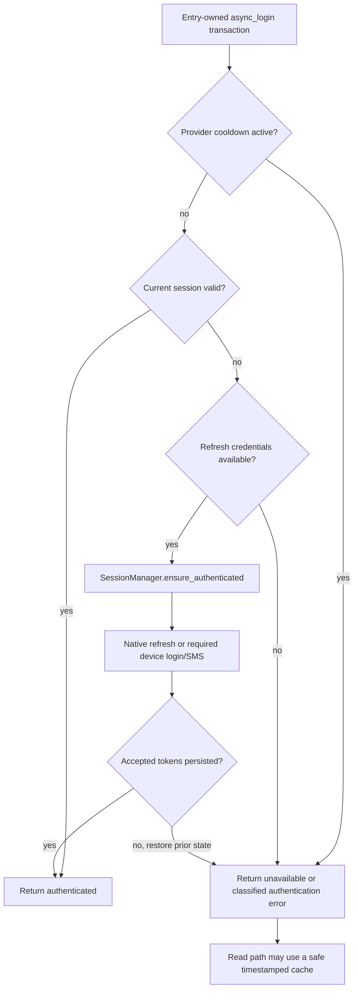

# Diagram — authentication and native refresh

The login lock serializes the entry's authentication transaction. Device-bound
SMS is guided through config/reauth flow when required; a background refresh
cannot prompt interactively. Authentication is published only after persistence.
Push binding commits only with the accepted session. Cache fallback belongs to
reads and never proves completion of a physical alarm command.
See [authentication contract](../../../specs/native-authentication-and-session-lifecycle.md).
