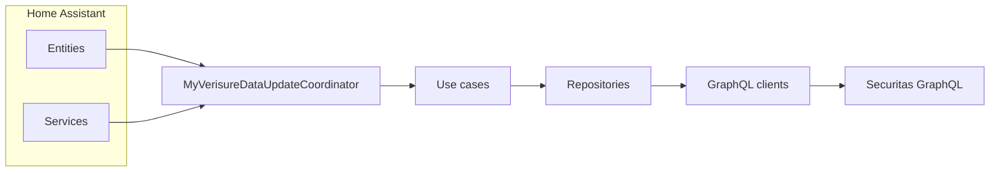

# Architecture (developer overview)

1. **Entities & services** call coordinator methods or read `coordinator.data`.
2. **Coordinator**, an HA adapter, manages authentication and configured polling, composes pure application policies and publishes persisted snapshots with stale-read protection.
3. **Use cases** encapsulate operational workflows (arm/disarm, list installations, refresh cameras).
4. **Application ports** define required operations; repositories and API clients implement the outer adapters. Domain values remain independent of transport DTOs.
5. **BaseClient** executes HTTP GraphQL with auth headers from `SessionManager`.

For layered detail see [Architecture docs](../architecture/layers.md).

Optional notifications add a receiver → strict mapper → entry-owned application
hub path. Read-only verification is composed by `notification_runtime.py`, while
`event.py` projects safe events into HA. Notifications do not invoke alarm commands.
The [notification contract](../../specs/notification-observability-and-automation.md)
and [composition guide](dependency-injection.md) describe ownership and limits.
