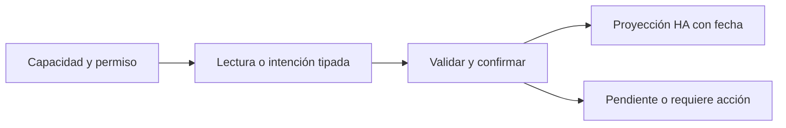

# Actividad, buzón, contadores e incidencias

- Status: Draft
- Date: 2026-11-24
- Catalog capability ID: activity-inbox-and-incidents
- Last verified: 2026-11-24, investigación y diseño; implementación futura
- Owners: My Verisure maintainers
- Scope: historial del proveedor, buzón nativo y seguimiento de incidencias sin confundirlos con FCM
- Required review gates: behavior, architecture, testing, documentation, security/operations
- Open decisions blocking readiness: protocolo de almacenamiento/recuperación del buzón detrás del SDK, paginación/retención y semántica de leído/borrado; contrato de informes completos e historial para cada servicio

## 1. Executive summary

Dar acceso a actividad y avisos mediante fuentes identificadas, con filtros y fechas correctas. Conservar separados los eventos HA existentes, el historial de actividad, los mensajes del buzón y las incidencias atendidas por la central.

Se aplica íntegramente la [base común de gestión](app-management-foundation.md), especialmente permisos, admisión, privacidad, confirmación y aislamiento.

## 2. Problem, current behavior and evidence

Se observó el buzón en la app nativa; Chrome redirigió su misma ruta a Page unauthorised. El puente contiene notifications.getNotifications/getNotificationInfo/getNotificationsNum/deleteNotification. El GraphQL NotificationsNotifier devuelve sólo category/unread, no mensajes completos. La baseline ya recibe/normaliza push e interpreta incidencias.

La [auditoría](../docs/technical/2026-11-24-app-capability-audit.md) y el [inventario de operaciones](../docs/validation/2026-11-24-app-capabilities.json) separan fuente estática, UI nativa/web y consultas observadas. Este SDD no declara nuevas funciones instaladas.

## 3. Actors, surfaces and terminology

Notificación FCM, evento reported/confirmed, señal de actividad, mensaje de buzón, contador unread e incidencia tienen IDs y ámbitos diferentes. Un idSignal no es universal.

Actores: usuario HA autorizado, principal/rol Verisure, recurso de la cuenta o instalación y adaptadores HA/CLI. La visibilidad de un menú no otorga permisos de backend.

## 4. Goals, non-goals and fixed invariants

- HIST-1 — **Fuentes independientes:** Mantener modelos separados para actividad, buzón y resultados; no presentar NotificationsNotifier como un endpoint de historial completo.
- HIST-2 — **Tiempo y entrega:** Conservar fecha de origen, recepción y observación; contenido restaurado/recuperado no se publica como evento nuevo.
- HIST-3 — **Consulta acotada:** Validar filtros, intervalo, paginación y cuota; deduplicar por identidad de fuente y mantener referencia opaca.
- HIST-4 — **Incidencias:** Separar aviso de incidente de su estado verificado e informe; aceptar sólo recursos autorizados y no generar respuesta operativa a emergencias.
- HIST-5 — **Buzón nativo:** No falsear flags nativos ni autorización; sólo implementar su lectura cuando exista un protocolo legítimo confirmado para el receptor/servicio.
- HIST-6 — **Lectura y borrado:** Marcar leído o borrar son acciones explícitas separadas, con ámbito y confirmación; no ejecutarlas al construir una entidad.
- HIST-7 — **Privacidad:** No copiar títulos/cuerpos libres, actor/DNI/teléfono, ubicación o URLs firmadas a Recorder; usar proyecciones seguras o respuestas privadas bajo demanda.
- HIST-8 — **Compatibilidad FCM:** Reutilizar el receptor y vocabulario existentes; no inferir entrega global ni reconstrucción completa de una caída.

Las pruebas domésticas mantienen la prohibición de interior total. No se realizan compras, emergencias o actuaciones físicas por inferirlas de una notificación.

## 5. Current versus intended journey

Equivalente: permiso del recurso → lectura/intención concreta → validación y confirmación → representación HA. Si falta contrato, permiso o resultado, no se publica un éxito. El estado actual es investigación; la implementación seguirá esta separación.

## 6. Functional behavior and state model

| Fuente | Referencia | Límite |
|---|---|---|
| Actividad | `ActV2Home` → `xSActV2`, `xSGetSignals` | tipos y filtros no son IDs FCM |
| Contadores | `NotificationsNotifier` | category/unread únicamente |
| Buzón | RPC nativa `notifications.*` | backing API/SDK sin establecer en esta auditoría |
| Incidencias | `xSSmartNotificationsOpenIncidenceList` | la baseline ya usa la lista; informes amplios necesitan evidencia |
| Panel informativo | `xSGetPromptList` | prompts no equivalen a sensores continuos |

Proponer una API de lectura paginada con origen, freshness y cobertura. Una vista HA puede combinar listas manteniendo sus tipos, pero jamás unificar IDs por coincidencia. Fechas desconocidas quedan sin fecha verificable. Las imágenes/enlaces de una señal se resuelven mediante el adaptador multimedia autorizado, sin iniciar capturas nuevas.

`notifications.setTopicsPush` y `pushNotifications.setPushEnabled` son funciones
del bridge del dispositivo. No usarlas para silenciar el teléfono ni copiar sus
preferencias al receptor HA. Cualquier futura suscripción de nuestro receptor
necesita ámbito y contrato propios; desactivar una entidad HA no marca mensajes
leídos, borra historial ni cambia los avisos de otros dispositivos.

Aplicar estados unknown/stale/pending/confirmed/partial/ambiguous según la base común. Un resultado antiguo, duplicado o cancelado no sustituye hechos más recientes.

## 7. User-facing configuration

Lectura histórica y buzón desactivados por defecto; filtros explícitos por fuente y rango. Preferir servicios con respuesta y una vista privada de historial; los eventos HA conservan el contrato existente. Retención local adicional opt-in con cota de 100 metadatos saneados/7 días como presupuesto inicial revisable; sin cuerpos crudos.

## 8. Clean Architecture design

Puertos `ActivityRepository`, `NotificationInboxRepository`, `IncidentRepository`; modelos de dominio separados y adaptadores HA sobre la baseline notification hub. No insertar un segundo consumidor FCM ni poner consultas lentas en la ruta que completa fotografías.

Las rutas y tipos anteriores son propuestas. Reutilizar el grafo por entrada, las sesiones, el gate de proveedor y los mecanismos de publicación existentes. Extender el guardián de arquitectura y comprobar importaciones sin HA.

## 9. UI/UX and content contract

Etiquetas «Actividad», «Mensaje del buzón», «Aviso recibido» y «Resultado confirmado». Mostrar fuente, fecha y antigüedad; no usar el mismo icono para recibido y verificado. Una familia no soportada explica el límite del SDK.

Etiquetas accesibles, localización y controles equivalentes en móvil/escritorio. Las acciones propuestas aún no existen en la versión instalada.

## 10. Failure, recovery and cleanup

Tras caída, reconciliar estado y solicitar páginas explícitas; no prometer recuperar todo el push perdido. Mantener cursores sólo con validez conocida. Una lectura parcial indica faltantes sin borrar el historial anterior ni confirmar incidentes.

Unload cancela seguimiento y drena persistencia; no equivale a deshacer la operación remota. Limpiar temporales propios conservando hechos confirmados y evidencia privada mínima.

## 11. Security, permissions and privacy

Respuestas detalladas sólo con ámbito y permiso adecuados. Separar servicios personales de instalaciones. No seguir deep links arbitrarios del proveedor ni convertir textos en acciones HA. Borrado/lectura remota nunca son efecto colateral de un refresco.

Se aplican controles de ámbito/rol vigentes y autorización explícita de automatizaciones de APP-6/7. Fixtures sintéticas; ningún secreto, dirección, identificador doméstico o captura HAR se incorpora al repositorio.

## 12. Observability and operations

Consultas acotadas por página; presupuesto inicial 50 registros por página y 200 por petición, sujetos al contrato real. Agrupar reconciliaciones; no polling frecuente del buzón. Contadores de descarte y recuperación sin cuerpos ni identificadores.

Registrar duración, resultado y motivo local; sin mensajes arbitrarios del proveedor. Los presupuestos comunes son propuestas sujetas a medición, no límites oficiales.

## 13. Compatibility, migration, rollout and rollback

Habilitación por entrada y capacidad, primero lecturas, después escrituras manuales autorizadas. Preservar UUID, FCM, credenciales, unique_id y automatizaciones existentes. Eliminar/desactivar soporte local no modifica recursos remotos. Rollback mantiene snapshots privados versionados y deja las funciones incompatibles desactivadas.

## 14. Testing strategy and numeric budget

32 casos: ocho reglas por cuatro variantes; incluir página solapada, antigüedad sin timestamp, contador sin contenido, cuenta ajena y restauración sin replay.

Son mínimos propuestos para la futura implementación, no tests ya escritos ni cobertura medida. Usar relojes/repositorios/HTTP falsos y cero llamadas domésticas en CI; exigir 100% de líneas/rama en políticas críticas y constructores de mutaciones nuevos y respetar los gates del proyecto.

## 15. Documentation and discoverability

Mantener este SDD, [CATALOG.md](CATALOG.md), el inventario de operaciones y la auditoría. La futura implementación añadirá guía específica, acciones, permisos, migración y ejemplos con valores ficticios. No anunciar la capacidad como disponible antes de su aceptación.

## 16. Acceptance scenarios

| Requisito | Given / When / Then resumido |
|---|---|
| HIST-1 | Sólo hay contadores por categoría; se solicita mensajes; se declara no disponible sin fabricar registros. |
| HIST-2 | Se importa historia tras reinicio; las automatizaciones de live no vuelven a dispararse. |
| HIST-3 | Dos páginas solapan registros; aparecen una vez sin mezclar entradas. |
| HIST-4 | Llega SMARTNOT; se consulta la incidencia permitida sin desarmar ni cerrar el caso automáticamente. |
| HIST-5 | Chrome deniega la ruta; no se cambia la identidad para fingir que esa vista funciona. |
| HIST-6 | Se actualiza un contador HA; el buzón remoto conserva mensajes y lectura. |
| HIST-7 | Una señal trae un cuerpo con datos personales; el evento público conserva sólo categoría/fechas permitidas. |
| HIST-8 | No se recibió una familia durante un periodo; el diagnóstico mantiene cobertura desconocida y el sondeo sigue disponible. |

Cada escenario se descompone en variantes de tipos, autorización, error, concurrencia y recuperación según el presupuesto. La validación física requiere autorización concreta independiente.

## 17. Requirements traceability

| ID | Riesgo/función | Verificación futura | Responsable de implementación |
|---|---|---|---|
| HIST-1 | Fuentes independientes | Caso de aceptación HIST-1; matriz sintética de §14 | Política/caso de uso y adaptador descritos en §8 |
| HIST-2 | Tiempo y entrega | Caso de aceptación HIST-2; matriz sintética de §14 | Política/caso de uso y adaptador descritos en §8 |
| HIST-3 | Consulta acotada | Caso de aceptación HIST-3; matriz sintética de §14 | Política/caso de uso y adaptador descritos en §8 |
| HIST-4 | Incidencias | Caso de aceptación HIST-4; matriz sintética de §14 | Política/caso de uso y adaptador descritos en §8 |
| HIST-5 | Buzón nativo | Caso de aceptación HIST-5; matriz sintética de §14 | Política/caso de uso y adaptador descritos en §8 |
| HIST-6 | Lectura y borrado | Caso de aceptación HIST-6; matriz sintética de §14 | Política/caso de uso y adaptador descritos en §8 |
| HIST-7 | Privacidad | Caso de aceptación HIST-7; matriz sintética de §14 | Política/caso de uso y adaptador descritos en §8 |
| HIST-8 | Compatibilidad FCM | Caso de aceptación HIST-8; matriz sintética de §14 | Política/caso de uso y adaptador descritos en §8 |

Tests propuestos: `test_activity_history.py, test_notification_inbox.py, test_incident_reports.py, test_history_privacy.py`. Son nombres de trabajo futuros, sin atribuirles ejecución actual. La evidencia disponible está en §2/6; los bloqueos del encabezado deben cerrarse antes de Ready for implementation.

## 18. Implementation or maintenance sequence

Revisar contratos y bloqueos → modelos/puertos semánticos → casos de uso con fakes → matriz de errores/privacidad → adaptador proveedor → presentación HA/CLI → compatibilidad/migración → lecturas controladas → escrituras concretas autorizadas cuando apliquen → rollout. No usar una prueba física peligrosa para completar una matriz sintética.

## 19. Definition of Done

- [ ] Requisitos y escenarios trazados; bloqueos de protocolo/permiso resueltos.
- [ ] Contratos por panel/hardware y confirmación comprobados.
- [ ] Tests, cobertura crítica, aislamiento, cancelación y privacidad verificados.
- [ ] Migración, rollback, guías y catálogo actualizados.
- [ ] Evidencia UI, sintética y física separadas, con sus límites publicados.

## 20. References and decisions

[Notificaciones ya implementadas](notification-observability-and-automation.md) · [Guía de eventos](../docs/automation-notifications.md) · [Ayuda de usuarios](https://www.verisure.es/cliente/datos?panel=fast)

[Base común](app-management-foundation.md) · [Norma de SDDs](README.md) · [Decisión de dependencias](../docs/adr/0001-core-and-adapter-dependencies.md). Estado Draft: la elección de exposiciones HA es una recomendación de diseño, no un comportamiento observado del proveedor.
