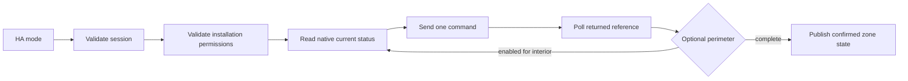

# Alarm modes and provider confirmation

- Status: As-built baseline
- Date: 2026-11-22
- Catalog capability ID: alarm-commands-and-state
- Last verified: 2026-11-22
- Owners: My Verisure maintainers
- Scope: HA mode mapping, command completion and authoritative state
- Required review gates: behavior, architecture, testing, documentation, security/operations
- Open decisions blocking readiness: live total/away acceptance is reserved to the owner; broader physical compound-operation recovery remains unverified

## 1. Executive summary

Home Assistant maps Verisure's independent interior/exterior protection into its
standard alarm modes. A configured option adds the perimeter after an interior
command. The UI must report provider-confirmed protection rather than the state
that existed before a successful command.

## 2. Problem, current behavior and evidence

Observed: an exterior command completed in about 1.8 seconds, but a redundant
post-command radio check received HTTP 403 and left HA showing the old disarmed
state. The owner independently confirmed that the exterior was actually armed.
The native app's completion response already contained the resulting panel code.

Current source retains that response and publishes recognized states directly.
Native captures verified D=disarmed, E=exterior, Q=partial night and C=partial night
plus perimeter. A later HA disarm completed in about 2.6 seconds without the extra
radio check. At 19:27 UTC, the installed integration renewed an actually expired
access token, refreshed installation permissions and completed Night+perimeter in
about 4.0 seconds. The following disarm completed in about 3.9 seconds including
HA-side persistence/notification, restoring D. These are individual observations.

An earlier disarm immediately after access-token renewal was rejected with stale
installation permissions. Reloading the installation context with the same token
made it succeed. Commands now require permissions bound to the current session
and refresh expired capability JWTs before sending a mutation.

Intentional contract: preserve the owner's mapping and optional perimeter behavior.
Known debt: live total/day combinations are not established by this validation.
The notification iteration now serializes the whole compound command per physical
installation and rejects older state publications, including across entries.
Its synthetic regressions are in `test_notification_state_epochs.py` and the
[notification contract](notification-observability-and-automation.md). Historical
reasons for the original aggressive polling/change of identifiers are not established.

## 3. Actors, surfaces and terminology

| Surface/term | Meaning |
|---|---|
| En casa / Home | perimeter command `PERI1` |
| Noche / Night | interior partial-night `ARMNIGHT1`, plus perimeter when configured |
| Ausente / Away | interior total `ARM1`, plus perimeter when configured |
| Disarm | provider `DARM1`, followed by bounded completion polling |
| Command accepted | initial provider reference; not completion |
| Command confirmed | completion response with `res: OK` |
| State known | completion/status evidence maps to a complete recognized zone combination |

The standard HA mode name is not itself a provider zone description. Detailed
sensors/attributes preserve interior day, night, total and exterior separately.
The owner explicitly confirmed Home remains exterior-only PERI1. Preserve this
mapping and its existing automation behavior.

## 4. Goals, non-goals and fixed invariants

- ALARM-1: each public mode MUST resolve through the defined provider mapping.
- ALARM-2: the perimeter option MUST remain configurable and apply to Away and Night.
- ALARM-3: a command MUST authenticate, bind valid installation permissions to that session before mutation, and poll only its returned reference.
- ALARM-4: recognized completion state MUST publish without a redundant panel radio check.
- ALARM-5: missing/unsupported confirmation or an unconfirmed attempted mutation MUST invalidate stale state.
- ALARM-6: a failed follow-up state read MUST NOT reclassify a confirmed command as rejected.
- ALARM-7: live QA MUST obey current owner authorization, permitted modes, pauses and restoration requirements.

This capability does not infer unknown provider codes, force an arm past exceptions,
operate locks, generate SOS events or authorize autonomous real-house testing.

## 5. Current versus intended journey

Text equivalent: selected mode → valid session and permissions → current provider status → command
and bounded confirmation → optional perimeter command → publish final confirmed
state. The old extra radio check is eliminated for recognized codes. A malformed
current-status response stops arming before a mutation.

## 6. Functional behavior and state model

| State | Fact | UI/next step |
|---|---|---|
| Disarmed | complete D state | arm a permitted mode |
| Arming/disarming | service call is still running | transition indicator; await result |
| Armed home | recognized E | exterior active |
| Armed night | recognized Q or C | night active; exterior reflects the code |
| Unknown | absent/unsupported or unconfirmed facts | inspect/recover; do not display an old disarmed state |
| Cooldown | provider refusal/backoff | wait; do not resend the mutation |

Each completion poll is tied to the initial reference and increasing counter.
WAIT uses one-second intervals for command completion, bounded to 30 attempts.
Legacy radio status checks retain 15-second intervals and ten attempts. Routine
reads prefer native `Status` for known codes; other codes retain strict legacy
message interpretation. Unsupported command confirmations first publish unknown,
then attempt the bounded read without converting its failure into command failure.

Cancellation clears the HA entity's transition indicator. Dedicated serialization,
remote idempotency and exact recovery from a failed second compound command remain
known debt; never automatically replay a mutation to obtain a nicer UI result.

## 7. User-facing configuration

| Setting | Default | Semantics |
|---|---|---|
| `scan_interval` | 10 minutes | background installation/state update |
| `auto_arm_perimeter_with_internal` | false for new entries | append perimeter after successful Away/Night interior arm |
| entry options | override stored entry data where implemented | snapshot at command dispatch |

The validated owner's entry has the perimeter option enabled. Recommended examples:
enabled for Night=partial night plus perimeter; disabled for Night=partial night
alone. The integration must not silently change that preference when interpreting
HA's standard mode names. Provider expiry and unknown-state handling are fixed rules.

## 8. Clean Architecture design

| Boundary | Actual owner |
|---|---|
| HA entity/service lifecycle | `alarm_control_panel.py`, `services.py` |
| Entry-owned orchestration | coordinator and `coordinator_alarm_commands.py` |
| Semantic use case/repository | `AlarmUseCase`, `AlarmRepository` implementations |
| Provider workflow | `AlarmCommandWorkflow`, request policy and poller |
| Pure status translation | `AlarmStatusService`, `analyze_alarm_state` |

Dependency constraints are executed by `scripts/architecture_guard.py`. Public
domain results carry the bounded confirmation code, not provider credentials or
an HTTP response. The entity awaits the service with `blocking=True` so the
transition lasts until the operation completes.

The application dispatcher receives `installation_id: str`, not a Home Assistant
config-entry shape. `get_status` raises a sanitized HA error for a missing
installation or unsuccessful refresh, including failures recorded by the
coordinator without a raised exception. The CLI propagates batch authentication
and installation-selection policy; noninteractive alarm writes require the
explicit `--no-confirm` flag. These contracts are tested offline.

## 9. UI/UX and content contract

| Condition | Representative primary view |
|---|---|
| Pending | “Armando” / “Desarmando” |
| Exterior | “Armada en casa”; detailed state “Perimeter Active” |
| Night and perimeter | “Armada noche”; “Internal Night and Perimeter Active” |
| Unsupported confirmation | unknown state; no fabricated disarmed label |
| Rejected/unconfirmed | operation error; inspect actual panel state before retrying |
| Complete disarm | “Desarmada”; all four zone flags false |

Standard HA controls supply keyboard, screen-reader and mobile behavior. Detailed
sensor text currently includes English labels even with a Spanish HA locale; full
sensor localization is documented debt, not completed acceptance. A successful
physical effect followed by a failed read is a partial observation outcome, not
proof that arming failed.

## 10. Failure, recovery and cleanup

No authenticated session means no mutation. Provider GraphQL errors and malformed
references fail closed. HTTP 403 starts local backoff; an operator may need a longer
provider-directed pause. After an ambiguous attempted mutation, display unknown
and verify the panel rather than retrying blindly. Retain a sanitized timestamp,
operation and stage; remove private captures after the contract is extracted.
If permission refresh fails or authentication changes during that refresh, stop
before sending the alarm command. Never replay a rejected mutation automatically.

## 11. Security, permissions and privacy

The account owner authorizes real alarm control. A live validation plan records
which modes are permitted and the original state. During the 2026-11-22 session,
total/away is forbidden because the owner is home; exterior and partial night are
allowed except during explicit terrace pauses. This restriction governs the test
session and does not remove the owner's production Away feature.

## 12. Observability and operations

Measure command start to completion independently of later UI observation.
Safe request names at INFO establish command/poll ordering without logging secrets.
The live exterior and disarm figures are individual observations, not an SLA.
Record native HTTP Date resolution as approximate; reused HAR connection start
timestamps are unsuitable for end-to-end latency claims.

## 13. Compatibility, migration, rollout and rollback

Preserve config entry ID, original alarm entity ID and device area so existing
dashboards/automations continue to resolve. The registry migration keeps the old
alarm's entity ID when the newly scoped duplicate has no custom settings. Keep a
private registry/source rollback before deployment. A source rollback does not
reverse a physical alarm command; restore the state separately when authorized.

## 14. Testing strategy and numeric budget

Maintenance minimum: 8 mapping/option cases, 8 acceptance/polling cases, 6 malformed
response/unknown cases, 5 HA transition/error cases, 4 migration/isolation cases and
3 cooldown/cancellation cases: 34 distinct cases. Use synthetic responses, fake
clocks and injected sleep; no unit test contacts the real alarm.

Run the existing suite, type/lint/architecture/distribution gates and coverage
report. The ten notification modules now require complete executable line/branch
coverage; no repository-wide percentage is enforced. Live evidence
must explicitly list which modes were exercised; synthetic Away tests do not
establish live total acceptance.

## 15. Documentation and discoverability

| Path | Change |
|---|---|
| `docs/user-guide/configuration.md` | update mode/option distinction and units |
| `docs/api-reference/services/arm-home.md` | document exterior mapping |
| `docs/api-reference/services/arm-night.md` | document optional perimeter |
| `docs/api-reference/entities/alarm-control-panel.md` | document confirmation and unknown state |
| `specs/catalog.json` | register code, tests and workflow evidence |

## 16. Acceptance scenarios

1. ALARM-1/2: with the option disabled, Night sends only ARMNIGHT1 and confirms Q; enabled sends ARMNIGHT1 then PERI1 using Q as current status and confirms C.
2. ALARM-3: authentication failure or malformed native current status prevents mutation.
3. ALARM-4: D/E/Q/C completion updates all zone flags with no subsequent radio check.
4. ALARM-5: a failed/unconfirmed command cannot leave the prior disarmed state represented as current.
5. ALARM-6: a confirmed unsupported code followed by blocked refresh remains accepted with unknown state.
6. ALARM-7: an owner pause stops all agent alarm writes; allowed testing resumes only after the owner's explicit return.

## 17. Requirements traceability

| Requirement | Owner | Test/evidence |
|---|---|---|
| ALARM-1/2 | repository and command metadata | `test_current_native_alarm.py`, `test_coordinator_alarm_commands.py` |
| ALARM-3 | client/coordinator auth | `test_alarm_client_contracts.py`, `test_coordinator_update_boundaries.py` |
| ALARM-4/5/6 | poller, status service, coordinator | `test_alarm_command_poller.py`, `test_coordinator_update_boundaries.py` |
| ALARM-7 | controlled live operator plan | dated live validation plan and owner's session instructions |
| HA lifecycle/identity | entity adapter and migration | `test_alarm_control_panel_lifecycle.py`, `test_entity_registry_migration.py` |

Full paths and related documentation are in the catalog.

## 18. Implementation or maintenance sequence

Preserve this baseline. For protocol changes: capture the permitted native mode,
write a synthetic failing contract, adjust pure mapping/workflows, verify HA
transitions and registry compatibility, update docs, then run spaced authorized
live cycles and restore the agreed state.

## 19. Definition of Done

- [x] Mapping, optional perimeter, confirmation and unknown-state contracts are recorded.
- [x] Native D/E/Q/C and HA exterior/disarm evidence are identified.
- [x] Installed HA Night+perimeter cycle after real token expiry and complete restoration were observed.
- [x] Owner confirmed Home remains exterior-only PERI1.
- [ ] Maintainers review concurrency/compound-failure debt and test allocation.
- [ ] Owner performs reserved total-mode verification in a suitable later session.

## 20. References and decisions

The [notification audit](../docs/technical/notification-audit-and-design.md)
reproduced stale-read publication and incomplete transport cooldown enforcement.
Command serialization also remains a prerequisite before enabling notification-driven
state refresh. This is new synthetic/code evidence, not a new physical alarm test.

The owner's clarification preserves the existing perimeter option for both interior
modes. No change to that preference is proposed. Primary protocol evidence is the
official native app capture; raw captures are intentionally private. See the
[authentication baseline](native-authentication-and-session-lifecycle.md) and
[entity/data baseline](installation-cameras-and-entity-identity.md), plus the
[dated validation report](../docs/validation/2026-11-22-live-verisure.md).
