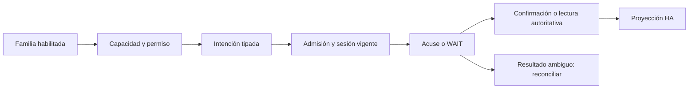

# Base común para ampliar las funciones de My Verisure en HA

- Status: Draft
- Date: 2026-11-24
- Catalog capability ID: app-management-foundation
- Last verified: 2026-11-24, investigación y diseño; implementación futura
- Owners: My Verisure maintainers
- Scope: descubrimiento, autorización, operaciones, privacidad y ciclo de vida comunes a las nuevas capacidades
- Required review gates: behavior, architecture, testing, documentation, security/operations
- Open decisions blocking readiness: matriz de permisos por panel/rol, presupuestos medidos y contratos de confirmación de cada escritura

## 1. Executive summary

Ampliar la integración por capacidades independientes, con lecturas bajo demanda,
comandos tipados y resultados confirmados. El catálogo de la app es una fuente de
investigación; no constituye una autorización del proveedor ni una promesa de
soporte de todos los dispositivos. Los once SDDs Draft describen trabajo futuro.

## 2. Problem, current behavior and evidence

La [auditoría global](../docs/technical/2026-11-24-app-capability-audit.md) distingue
la web 3.8.0, el WebView nativo 10.192.1/3, las consultas observadas y los contratos
estáticos. El [inventario](../docs/validation/2026-11-24-app-capabilities.json)
asigna 263 nombres de operación GraphQL (278 variantes) y 152 comandos del puente nativo. Un comando del
puente es una llamada al SDK del móvil, no un endpoint HTTP reutilizable.

Las cinco capacidades as-built conservan su alcance actual. Esta especificación
no cambia las plataformas, acciones ni opciones de la integración instalada 1.1.0.

## 3. Actors, surfaces and terminology

La cuenta puede tener varias instalaciones y servicios personales. Cada entrada
HA posee sesión, identidad nativa, grafo de dependencias y tareas. El administrador
HA, el titular Verisure, un usuario restringido y un dispositivo autorizado son
principales distintos. **Disponible**, **contratado**, **permitido**, **soportado
por el adaptador** y **verificado** son dimensiones independientes.

Una operación diferencia intención, admisión, acuse del servidor, confirmación
autoritativa y publicación local. `WAIT`, un `referenceId` o HTTP 200 no prueban
que la casa, una llave o una rutina hayan cambiado.

## 4. Goals, non-goals and fixed invariants

- APP-1: descubrir capacidades con datos de servicios/roles del proveedor; conservar desconocido y denegar escrituras sin permiso positivo.
- APP-2: habilitar cada familia por entrada, desactivada inicialmente, reutilizando descubrimiento existente y sin añadir una ráfaga de inicio.
- APP-3: exponer puertos y acciones semánticos tipados; prohibir proxies públicos de GraphQL, RPC nativa o JSON de proveedor arbitrarios.
- APP-4: compartir admisión/cooldown por origen y orden de mutaciones por instalación; mantener generaciones de recurso y aislar cuentas.
- APP-5: confirmar resultados antes de cambiar estados HA; no repetir mutaciones ambiguas, no idempotentes o restauradas tras reinicio.
- APP-6: separar autenticación ordinaria, autorización del terminal y confirmación de acciones protegidas; nunca fabricar una prueba del móvil.
- APP-7: mantener secretos/identificadores privados fuera de atributos, Recorder, trazas y diagnósticos; exportar sólo proyecciones permitidas.
- APP-8: poseer/cancelar/drenar tareas y persistencia por entrada, conservando el sondeo y las identidades ya existentes.

Las operaciones de emergencia, compras, consentimiento contractual y destrucción
de datos no se convierten en acciones automáticas por aparecer en el cliente.
Las pruebas domésticas continúan prohibiendo el armado interior total.

## 5. Current versus intended journey

Equivalente: habilitación explícita → permiso → intención validada → admisión →
acuse → confirmación → publicación. La reconciliación consulta hechos actuales;
no reenvía el comando anterior.

## 6. Functional behavior and state model

| Estado | Hecho | Tratamiento |
|---|---|---|
| `unsupported` | adaptador/panel sin contrato | sin control ejecutable; motivo visible |
| `not_entitled` / `unauthorized` | servicio/rol insuficiente | sin reintentos ni ampliación de permisos |
| `unknown` / `stale` | dato ausente o antiguo | conservar fecha; no mostrar falso/off confirmado |
| `pending` | operación admitida sin resultado | mostrar progreso y plazo |
| `confirmed` | resultado vigente y validado | publicar una vez, con generación y fecha |
| `partial` | sólo una fase confirmada | mostrar qué cambió; no compensar permisos a ciegas |
| `ambiguous` | envío posible sin confirmación | bloquear repetición automática y reconciliar |

Cada recurso conserva generación, fuente, fecha de observación y ámbito. Un dato
anterior a una escritura no puede sobrescribir su resultado. Duplicados de una
intención confirmada son no-op; una nueva intención requiere nueva autorización.
Cancelar la espera local no demuestra cancelar el trabajo remoto.

## 7. User-facing configuration

Propuesta: `management_enabled` y opciones por familia, todos booleanos con valor
inicial `false`; `management_automations` será una lista explícita de acciones
permitidas, inicialmente vacía. Mostrar diagnóstico de capacidades sin registrar
automáticamente todas las entidades administrativas. Los nombres son propuestos,
no opciones disponibles en 1.1.0.

Los secretos se introducen en flujos de configuración protegidos, sin precargar
OTP, PIN o palabras clave en formularios normales. La alternativa inicial de
menor superficie es ofrecer sólo acciones de lectura bajo demanda.

## 8. Clean Architecture design

Futuros modelos/políticas en `core/application/management/`; puertos semánticos en
`core/repositories/interfaces/management/`; casos de uso en `core/use_cases/`;
clientes/DTOs en `core/api/management/` y repositorios en `core/repositories/implementations/`.
El coordinador HA y `management_services.py` adaptarán esos casos de uso. La CLI
podrá consumir los mismos puertos sin importar Home Assistant.

Reutilizar el grafo de `core/dependency_injection/module.py`, la admisión de
`core/api/provider_request_gate.py`, autenticación y el orden físico definido por
`coordinator.py`. No crear sesiones globales ni un segundo receptor FCM. Los
modelos de dominio no importarán aiohttp, HA, Pillow, filesystem ni GraphQL.

El guardián AST deberá incluir las nuevas rutas; tests de importación sin HA y de
dos entradas comprobarán independencia. No se crearán módulos vacíos como prueba
de que una función está implementada.

## 9. UI/UX and content contract

Mensajes: «Consultando configuración…», «Esperando confirmación del panel»,
«Hace falta verificar una acción en la app», «Permiso insuficiente»,
«Resultado sin confirmar; consulta el estado antes de repetir» y «Guardado y verificado».
No mostrar éxito por un acuse. Cada entidad/control identifica recurso y entrada,
cuenta con etiqueta accesible y mantiene el mismo estado en escritorio y móvil.

## 10. Failure, recovery and cleanup

Una fase fallida conserva hechos ya confirmados. Si hay cambio remoto confirmado
y fallo local de persistencia, distinguir ambos resultados y reconciliar después.
No ejecutar rollback remoto que reactive una llave, abra una cerradura o duplique
un programa. Reintentar lecturas sólo dentro del presupuesto del recurso.

Unloading cancela la admisión pendiente y los sondeos; drena escritores antes de
liberar su lock. Reiniciar restaura metadatos privados mínimos y consulta el
estado, sin reenviar escrituras ni publicar hechos históricos como nuevos.

## 11. Security, permissions and privacy

Las escrituras administrativas requieren permiso proveedor renovado para la
sesión/instalación actual y usuario HA autorizado. Un contexto de automatización
sin usuario no se trata como administrador: necesita una autorización previa y
acotada del propietario. Los recursos se resuelven por referencias opacas locales;
no se aceptan IDs de otra entrada ni URLs arbitrarias.

Los pasos protegidos requieren intención, recurso, caducidad y uso único. Una
sesión válida o un token FCM no sustituyen la autorización de alta seguridad.
Guardar material privado con permisos 0600; no persistir OTP usados. Alias que el
usuario decida mostrar no habilitan publicar DNI, móviles, ubicación, seriales,
tokens, PIN, palabras clave o cuerpos libres del proveedor.

## 12. Observability and operations

Medir por recurso: admisiones, consultas, duración, resultados, descartes,
cooldown, cancelación y reconciliación, con códigos locales y sin cuerpos privados.
Los siguientes son presupuestos iniciales propuestos, no límites publicados:
metadatos con TTL de 5 minutos y marca de antigüedad; sólo lecturas explícitas para
radio; hasta 12 consultas de estado separadas al menos 5 segundos, con plazo total
de 65 segundos incluyendo HTTP. Ajustarlos únicamente con evidencia controlada.

El tráfico de fondo se agrupa y difiere ante comandos de alarma. No retener la
admisión HTTP durante esperas. Una mutación de configuración ya enviada puede
ocupar el panel: declarar esa limitación, priorizar nuevas admisiones de seguridad
y no prometer interrumpir una operación remota que el protocolo no cancela.

## 13. Compatibility, migration, rollout and rollback

Rollout por familia y panel, empezando por lectura, luego escritura manual y por
último automatización autorizada. Preservar UUID, FCM, credenciales, entidades y
opciones de 1.1.0. Nuevas entidades desactivadas por defecto cuando corresponda;
retirar una opción detiene consultas sin borrar la configuración de Verisure.
Rollback de código conserva un formato privado versionado y no cambia la casa.

## 14. Testing strategy and numeric budget

Presupuesto mínimo futuro: 30 casos distintos: 8 permisos/ámbitos, 8 orden y
generaciones, 6 cancelación/reinicio, 4 admisión/cooldown y 4 privacidad.
Usar reloj determinista, repositorios falsos y HTTP sintético; cero llamadas
domésticas en CI. Exigir 100% de líneas/rama en nuevas políticas críticas y
constructores de mutaciones, además del mínimo vigente del proyecto. No hay
todavía cobertura de implementación de estas capacidades Draft.

## 15. Documentation and discoverability

Mantener este SDD, el [catálogo](CATALOG.md), el inventario de operaciones y la
auditoría. La futura implementación añadirá guías de acciones y ejemplos con
valores sintéticos, dependencias y permisos explícitos. El README diferencia
capacidades instaladas y planificación.

## 16. Acceptance scenarios

| Requisito | Given / When / Then |
|---|---|
| APP-1 | Permiso desconocido; se pide escribir; se rechaza antes de HTTP. |
| APP-2 | Entrada recién actualizada; arranca HA; ninguna familia Draft provoca consultas nuevas. |
| APP-3 | Payload con operación arbitraria o recurso ajeno; llega al adaptador; el esquema lo rechaza. |
| APP-4 | Dos entradas comparten instalación/origen; compiten comandos; se ordenan sin mezclar cuentas ni ignorar cooldown. |
| APP-5 | Escritura enviada y timeout; se reinicia; sólo se reconcilia, sin repetir el envío. |
| APP-6 | Login válido sin terminal autorizado; se pide acción protegida; aparece el paso requerido, sin fingir autorización. |
| APP-7 | Respuesta con tokens y datos personales; se proyecta; estados/diagnósticos sólo contienen campos permitidos. |
| APP-8 | Writer activo y unload; se cancela; su propiedad dura hasta completar/cerrar la escritura. |

## 17. Requirements traceability

| ID | Política/caso de uso propuesto | Test futuro y aceptación |
|---|---|---|
| APP-1 | Descubrir capacidades y resolver permiso positivo | `test_management_permissions.py`; escenario APP-1 |
| APP-2 | Habilitar familias por entrada sin consultas implícitas | `test_management_permissions.py`; escenario APP-2 |
| APP-3 | Validar intención y referencia semántica | `test_management_permissions.py`; escenario APP-3 |
| APP-4 | Admitir operaciones y ordenar generaciones por ámbito | `test_management_ordering.py`; escenario APP-4 |
| APP-5 | Confirmar/reconciliar sin replay de mutación | `test_management_ordering.py`; escenario APP-5 |
| APP-6 | Verificar intención protegida y autorización acotada | `test_management_permissions.py`; escenario APP-6 |
| APP-7 | Proyectar y persistir sólo material permitido | `test_management_privacy.py`; escenario APP-7 |
| APP-8 | Cancelar/drenar tareas y escritores por entrada | `test_management_lifecycle.py`; escenario APP-8 |

Los nombres de tests y módulos de §8 son futuros, no referencias a archivos ya
existentes ni evidencia de ejecución. Los treinta casos de §14 descomponen estos
escenarios en variantes independientes de ámbito, error, concurrencia y recuperación.

## 18. Implementation or maintenance sequence

Contratos por familia → modelos y reglas puras → repositorio simulado → pruebas
de riesgos → adaptador proveedor → HA/CLI → migración y diagnóstico → lectura
controlada → escritura manual autorizada y reversible → rollout por capacidad.
Una función cuyo contrato siga desconocido permanece sin control ejecutable.

## 19. Definition of Done

- [ ] Permisos, capacidades y confirmación verificados por cada panel soportado.
- [ ] Presupuestos y prioridad de alarmas medidos; sin ráfagas ni replay de comandos.
- [ ] Tests, aislamiento, cobertura, privacidad y arquitectura comprobados.
- [ ] Migración, rollback y documentación de cada familia revisados.
- [ ] Evidencia sintética, UI y física separadas; catálogo actualizado sólo con pruebas reales.

## 20. References and decisions

La [decisión de dependencias](../docs/adr/0001-core-and-adapter-dependencies.md),
la [norma de SDDs](README.md) y las cinco baselines siguen vigentes. Las decisiones
de este documento son propuestas para revisión; no modifican el comportamiento
instalado ni habilitan pruebas de alarmas por sí mismas.
