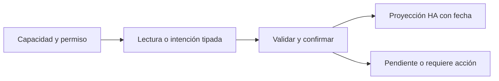

# Galerías, vídeo y configuración avanzada de cámaras

- Status: Draft
- Date: 2026-11-24
- Catalog capability ID: connected-camera-media
- Last verified: 2026-11-24, investigación y diseño; implementación futura
- Owners: My Verisure maintainers
- Scope: ampliación de fotos existentes a galerías, streaming y SDK de cámaras conectadas
- Required review gates: behavior, architecture, testing, documentation, security/operations
- Open decisions blocking readiness: capturas legítimas por familia con hardware disponible; protocolos/codec/renovación del stream y permisos; semántica de parámetros de SDK, eventos y almacenamiento SD

## 1. Executive summary

Ampliar multimedia según familia de cámara y autorización real, conservando la validación de fotos actual. Distinguir fotodetector YP/YR, cámaras conectadas/Verisure y Arlo: no comparten necesariamente streaming, tokens ni configuración.

Se aplica íntegramente la [base común de gestión](app-management-foundation.md), especialmente permisos, admisión, privacidad, confirmación y aislamiento.

## 2. Problem, current behavior and evidence

El cliente declara listados y tokens de vídeo, autorización Arlo, blacklists y metadatos de detección. El puente xsCameras declara eventos, streaming, vídeo SD, ajustes generales/eventos, Wi-Fi, horario, tarjeta SD y nombre. Esas llamadas delegan en un SDK nativo; no son evidencia de endpoints HTTP equivalentes ni de hardware validado en esta cuenta.

La [auditoría](../docs/technical/2026-11-24-app-capability-audit.md) y el [inventario de operaciones](../docs/validation/2026-11-24-app-capabilities.json) separan fuente estática, UI nativa/web y consultas observadas. Este SDD no declara nuevas funciones instaladas.

## 3. Actors, surfaces and terminology

Fotografía solicitada, miniatura, clip, evento de cámara, streaming, detección y tarjeta SD son recursos distintos. Un token de servicio de cámara no es el hash de login de la alarma.

Actores: usuario HA autorizado, principal/rol Verisure, recurso de la cuenta o instalación y adaptadores HA/CLI. La visibilidad de un menú no otorga permisos de backend.

## 4. Goals, non-goals and fixed invariants

- MEDIA-1 — **Familias y soporte:** Descubrir familia/capacidad y usar adaptador específico; conservar fotos YP/YR y no crear soporte de vídeo por un nombre de dispositivo.
- MEDIA-2 — **Galería y detección:** Leer galerías/clips por autorización y metadatos conocidos; no inferir identidad de personas ni convertir clasificación visual en estado de alarma.
- MEDIA-3 — **Streaming:** Administrar tokens efímeros, codec, sesiones y cierre; devolver fuentes privadas autenticadas, sin URLs firmadas ni tokens en atributos.
- MEDIA-4 — **Configuración:** Exponer sólo ajustes documentados por cámara: eventos/detección, horario, SD, nombre, Wi-Fi y privacidad; cada campo conserva su tipo y estado confirmado.
- MEDIA-5 — **Acciones destructivas:** Formatear SD, borrar grabaciones, emparejar cámaras o revocar autorizaciones no son acciones automáticas; mantener flujo oficial/manual hasta un contrato específico revisado.
- MEDIA-6 — **Privacidad:** Mantener separados permisos de alarma, cámara y usuario; respetar blacklists e instalaciones vinculadas sin ampliar OAuth ni licencias en background.
- MEDIA-7 — **Límites y compatibilidad:** Reutilizar cotas de imagen y commits completos existentes, añadir cotas de media/tiempo y cleanup; un fallo de streaming no invalida la recepción FCM.

Las pruebas domésticas mantienen la prohibición de interior total. No se realizan compras, emergencias o actuaciones físicas por inferirlas de una notificación.

## 5. Current versus intended journey

Equivalente: permiso del recurso → lectura/intención concreta → validación y confirmación → representación HA. Si falta contrato, permiso o resultado, no se publica un éxito. El estado actual es investigación; la implementación seguirá esta separación.

## 6. Functional behavior and state model

| Área | Referencia | Puerta de implementación |
|---|---|---|
| Cámara conectada | `mkGetAllCameras`, `VC4GenerateToken`, `VerisureCameraGenerateToken` | autorización/expiración/capacidad por familia |
| Arlo | Create/ConfirmArloAuthorization, UpdateConnectArloInstallation, AuthorisationRevoked | consentimiento y permisos de la cuenta externa |
| Privacidad/detección | StreamingBlacklists y `mkGetDetectionMetadata` | no publicar tokens, bounding boxes o actor privado sin propósito |
| SDK nativo | `xsCameras.getEvents/startStreaming/startSDVideo` | transporte real aún no establecido |
| Ajustes SDK | general/event/time/SD settings, camera name, Wi-Fi | metadatos y read-back por hardware |
| Destrucción | `xsCameras.formatSDCard` | flujo oficial; ninguna automatización por defecto |

Una sesión de vídeo pasa por autorizado → preparando → reproduciendo → expirado/cerrado. Las fotos mantienen su baseline separada. El inventario del SDK no prueba soporte de conversación de audio, visión nocturna o todos los controles en cada modelo: descubrirlos en metadata y bloquear lo no demostrado. No iniciar streams o nuevas fotos al recibir un evento cualquiera.

Aplicar estados unknown/stale/pending/confirmed/partial/ambiguous según la base común. Un resultado antiguo, duplicado o cancelado no sustituye hechos más recientes.

## 7. User-facing configuration

Familia desactivada por defecto y reproducción sólo bajo demanda. Entidades camera/media y acciones de galería/configuración propuestas por dispositivo. Ajustes complejos en flujo dedicado; no un JSON genérico. Proponer descargas privadas con caducidad y cota inicial de 64 MiB/120 s, revisable según formato real.

## 8. Clean Architecture design

Puertos `CameraMediaRepository`, `CameraSettingsRepository`, `StreamingSession`; adaptadores separados de fotodetector, cámara conectada y Arlo. HA adapta camera/stream/WebRTC únicamente tras validar la interfaz soportada por el runtime objetivo. Core no conoce URLs de HA ni el SDK del móvil.

Las rutas y tipos anteriores son propuestas. Reutilizar el grafo por entrada, las sesiones, el gate de proveedor y los mecanismos de publicación existentes. Extender el guardián de arquitectura y comprobar importaciones sin HA.

## 9. UI/UX and content contract

Indicar «Foto», «Clip», «Directo» y fuente/fecha. Mostrar si una función requiere la app oficial o vinculación externa. No mostrar una imagen antigua como directo ni un audio no soportado como control operativo.

Etiquetas accesibles, localización y controles equivalentes en móvil/escritorio. Las acciones propuestas aún no existen en la versión instalada.

## 10. Failure, recovery and cleanup

Revocación/expiración: cerrar sesión y solicitar reautorización específica, sin migrar a credenciales más amplias. Descarga parcial se descarta; clip confirmado ya guardado se mantiene privado. Un stream huérfano se cierra al descargar entrada.

Unload cancela seguimiento y drena persistencia; no equivale a deshacer la operación remota. Limpiar temporales propios conservando hechos confirmados y evidencia privada mínima.

## 11. Security, permissions and privacy

Validar hosts, HTTPS, tipos y tamaños; no seguir URLs recibidas sin allowlist del adaptador. Tokens y medios no se exportan por diagnósticos. Compartir una imagen o vincular Arlo requiere intención del usuario y destinatario/alcance concretos.

Se aplican controles de ámbito/rol vigentes y autorización explícita de automatizaciones de APP-6/7. Fixtures sintéticas; ningún secreto, dirección, identificador doméstico o captura HAR se incorpora al repositorio.

## 12. Observability and operations

Una reproducción activa por cámara inicialmente; ninguna sesión al arrancar. Telemetría de apertura/cierre/renovación, sin fotogramas ni URLs privadas. Evitar bucles de renovación/reconexión y preservar prioridades de seguridad.

Registrar duración, resultado y motivo local; sin mensajes arbitrarios del proveedor. Los presupuestos comunes son propuestas sujetas a medición, no límites oficiales.

## 13. Compatibility, migration, rollout and rollback

Habilitación por entrada y capacidad, primero lecturas, después escrituras manuales autorizadas. Preservar UUID, FCM, credenciales, unique_id y automatizaciones existentes. Eliminar/desactivar soporte local no modifica recursos remotos. Rollback mantiene snapshots privados versionados y deja las funciones incompatibles desactivadas.

## 14. Testing strategy and numeric budget

28 casos: siete riesgos por cuatro variantes, con expiración, permiso revocado, formato no soportado, bytes truncados, desconexión y aislamiento de dos cámaras/entradas.

Son mínimos propuestos para la futura implementación, no tests ya escritos ni cobertura medida. Usar relojes/repositorios/HTTP falsos y cero llamadas domésticas en CI; exigir 100% de líneas/rama en políticas críticas y constructores de mutaciones nuevos y respetar los gates del proyecto.

## 15. Documentation and discoverability

Mantener este SDD, [CATALOG.md](CATALOG.md), el inventario de operaciones y la auditoría. La futura implementación añadirá guía específica, acciones, permisos, migración y ejemplos con valores ficticios. No anunciar la capacidad como disponible antes de su aceptación.

## 16. Acceptance scenarios

| Requisito | Given / When / Then resumido |
|---|---|
| MEDIA-1 | Sólo existe fotodetector; se descubre; no aparece streaming no demostrado. |
| MEDIA-2 | Se recupera una foto histórica; no se emite photo_ready como captura nueva. |
| MEDIA-3 | Expira el token del stream; se renueva por su flujo y se cierra el anterior sin bucle. |
| MEDIA-4 | El SDK no confirma un ajuste; se mantiene pendiente/desconocido y no se aplica un valor por defecto. |
| MEDIA-5 | Se descubre una SD llena; no se formatea ni se borran clips por una automatización implícita. |
| MEDIA-6 | Un usuario carece de acceso a cámara; no recibe clips aunque pueda consultar la alarma. |
| MEDIA-7 | HA descarga un clip y se cancela; el temporal se limpia y la última foto válida permanece. |

Cada escenario se descompone en variantes de tipos, autorización, error, concurrencia y recuperación según el presupuesto. La validación física requiere autorización concreta independiente.

## 17. Requirements traceability

| ID | Riesgo/función | Verificación futura | Responsable de implementación |
|---|---|---|---|
| MEDIA-1 | Familias y soporte | Caso de aceptación MEDIA-1; matriz sintética de §14 | Política/caso de uso y adaptador descritos en §8 |
| MEDIA-2 | Galería y detección | Caso de aceptación MEDIA-2; matriz sintética de §14 | Política/caso de uso y adaptador descritos en §8 |
| MEDIA-3 | Streaming | Caso de aceptación MEDIA-3; matriz sintética de §14 | Política/caso de uso y adaptador descritos en §8 |
| MEDIA-4 | Configuración | Caso de aceptación MEDIA-4; matriz sintética de §14 | Política/caso de uso y adaptador descritos en §8 |
| MEDIA-5 | Acciones destructivas | Caso de aceptación MEDIA-5; matriz sintética de §14 | Política/caso de uso y adaptador descritos en §8 |
| MEDIA-6 | Privacidad | Caso de aceptación MEDIA-6; matriz sintética de §14 | Política/caso de uso y adaptador descritos en §8 |
| MEDIA-7 | Límites y compatibilidad | Caso de aceptación MEDIA-7; matriz sintética de §14 | Política/caso de uso y adaptador descritos en §8 |

Tests propuestos: `test_camera_media_contracts.py, test_stream_lifecycle.py, test_camera_settings.py, test_media_privacy.py`. Son nombres de trabajo futuros, sin atribuirles ejecución actual. La evidencia disponible está en §2/6; los bloqueos del encabezado deben cerrarse antes de Ready for implementation.

## 18. Implementation or maintenance sequence

Revisar contratos y bloqueos → modelos/puertos semánticos → casos de uso con fakes → matriz de errores/privacidad → adaptador proveedor → presentación HA/CLI → compatibilidad/migración → lecturas controladas → escrituras concretas autorizadas cuando apliquen → rollout. No usar una prueba física peligrosa para completar una matriz sintética.

## 19. Definition of Done

- [ ] Requisitos y escenarios trazados; bloqueos de protocolo/permiso resueltos.
- [ ] Contratos por panel/hardware y confirmación comprobados.
- [ ] Tests, cobertura crítica, aislamiento, cancelación y privacidad verificados.
- [ ] Migración, rollback, guías y catálogo actualizados.
- [ ] Evidencia UI, sintética y física separadas, con sus límites publicados.

## 20. References and decisions

[Baseline de fotos e identidad](installation-cameras-and-entity-identity.md) · [FCM de fotos](linux-push-photo-completion.md) · [Guía oficial](https://www.securitasdirect.es/alarmas/clientes/my-verisure-uso/)

[Base común](app-management-foundation.md) · [Norma de SDDs](README.md) · [Decisión de dependencias](../docs/adr/0001-core-and-adapter-dependencies.md). Estado Draft: la elección de exposiciones HA es una recomendación de diseño, no un comportamiento observado del proveedor.
