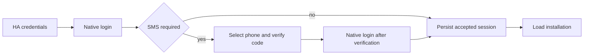

# Native authentication and session lifecycle

- Status: As-built baseline
- Date: 2026-11-22
- Catalog capability ID: native-authentication
- Last verified: 2026-11-23
- Owners: My Verisure maintainers
- Scope: account login, device verification and durable session renewal
- Required review gates: behavior, architecture, testing, documentation, security/operations
- Open decisions blocking readiness: future native profile/version updates require fresh provider evidence

## 1. Executive summary

An account verifies its integration-owned device by SMS when required. Subsequent
access uses its stored session and native refresh token. Authentication failure
must be visible and must not silently authorize alarm operations.

## 2. Problem, current behavior and evidence

Observed: the official native app issues 900-second access tokens and supports a
persistently verified device. Its successful response can contain a nullable
authorization flag. Its initial SMS challenge can omit access and refresh tokens.
The old Linux device profile was rejected by the provider; a phone ID of zero
was a valid SMS destination and was incorrectly rejected locally.

The current native profile, challenge binding, token projection and selection
delegation have regression coverage in
[`test_current_native_auth.py`](../custom_components/my_verisure/core/tests/unit/test_current_native_auth.py).
Controlled live evidence confirmed SMS acceptance, device reuse without another
SMS and native refresh-token renewal in approximately 200 ms. Raw credentials
and captures are not repository evidence.

Intentional contract: stable per-entry device identity, transactional token-pair
persistence and strict authorization. Known limitation: provider profile versions
and undocumented response shapes can change. Historic reasons for the previous
profile are unknown. A scheduled protocol compatibility audit is a future
operational decision, not an installed automation.

The optional FCM path selects an entry-owned OWA profile and sends its own token
as `idDevice`, retaining the UUID. Default OWI remains for unmigrated entries;
disabling the listener retains the verified profile. Login, renewal, SMS and data
calls share that context. No captured account identifier is required. Actual HA
login/restart and synthetic Android renewal are covered by the
[push baseline](linux-push-photo-completion.md) and
[installed receipt](../docs/validation/2026-11-23-ha-push.json).

## 3. Actors, surfaces and terminology

| Actor | Goal | Surface |
|---|---|---|
| Account owner | connect an installation and supply SMS when required | HA config/reauth flow |
| Verisure | validate credentials, device and session | native GraphQL transport |
| Integration | bind the challenge and persist accepted credentials | entry-scoped composition root |

Access token, refresh token, verified device and an in-progress SMS challenge are
different facts. Successful login is not successful persistence or successful HA setup.

## 4. Goals, non-goals and fixed invariants

- AUTH-1: a challenge MUST be bound to the pending account/device and expire after 300 seconds.
- AUTH-2: a selected phone ID MUST be a nonnegative integer; booleans and negatives are invalid.
- AUTH-3: accepted access/refresh material MUST persist transactionally; failures restore the prior state.
- AUTH-4: renewal MUST attempt the same account's native refresh token before password login.
- AUTH-5: failed authorization MUST prevent a subsequent alarm or camera mutation.
- AUTH-6: secrets and household identifiers MUST be absent from public diagnostics and ordinary logs.

Creating provider accounts, changing passwords, biometric enrollment and sharing a
native app's device identity are outside this capability.

## 5. Current versus intended journey

Text equivalent: credentials → native login → optional bound SMS verification →
accepted session persistence → installation loading. This baseline preserves that
journey; it does not request another SMS for every token expiration.

## 6. Functional behavior and state model

| State | Meaning | Next transition |
|---|---|---|
| Unauthenticated | no accepted usable session | login |
| Challenge pending | owner must select/verify a bound phone | SMS verification, expiry or cancellation |
| Authenticated | an accepted token is usable | operation or expiration |
| Expired, renewable | access expired; refresh/account context retained | native renewal |
| Reauthentication required | automatic authorization cannot complete | HA repair/config flow |
| Provider cooldown | provider has refused requests temporarily | wait, without retrying commands |

Pending challenges are cleared on cancellation, expiry and terminal errors.
Transport failures do not provoke an immediate password-login fallback. A provider
rejection of native renewal permits one registered-device login attempt. An
ambiguous tokenless response is not authenticated.

## 7. User-facing configuration

Credentials and installation selection belong to the config entry. SMS codes and
phone choice belong only to the pending challenge. Device identifiers belong to
the entry-owned storage directory. No UI setting extends a token's provider expiry.

Recommended operation: keep the verified device and let refresh run automatically.
Alternative: use HA reauthentication after an explicit provider rejection. Reusing
another account's session or treating missing authorization as false is invalid.

## 8. Clean Architecture design

| Boundary | Owner |
|---|---|
| Pure response and challenge decisions | `auth_response_classifier.py`, `otp_authorization.py` |
| Application orchestration | `AuthUseCaseImpl`, `SessionManager` |
| Semantic repository port | `AuthRepository` |
| Provider adaptation | `AuthClient`, auth DTO/projection and `DeviceManager` |
| HA entrypoint | `config_flow.py`, coordinator authentication policy |
| Persistence/composition | `FileManager`, entry-owned composition root |

`scripts/architecture_guard.py` enforces the repository dependency rules. Provider
DTOs do not become HA public attributes. SMS selection crosses the repository port
explicitly; it is not inferred independently in two mutable layers.

## 9. UI/UX and content contract

| Condition | Primary meaning | Human action |
|---|---|---|
| Login pending | Connecting to Verisure | wait |
| SMS required | Select the phone that should receive verification | select and enter received code |
| Wrong/expired SMS | Verification did not complete | restart the challenge when required |
| Persistence failed | Provider access was accepted, but local session storage failed | repair local storage; do not assume setup completed |
| Complete | Installation and entities are available | none |

Use existing English/Spanish HA translations. Provider tokens, passwords and raw
error payloads do not appear in these messages. HA's standard form widgets retain
keyboard, screen-reader and narrow-screen behavior; detailed locale parity remains
a manual review item.

## 10. Failure, recovery and cleanup

Invalid credentials produce an actionable auth error. Connection/cooldown errors
retain their types. Failed persistence rolls back credentials. A later nullable
device field failing setup does not justify claiming SMS verification failed.
Clear in-memory challenge state on terminal paths and remove only owned temporary
diagnostic files after extracting sanitized evidence.

## 11. Security, permissions and privacy

Use account-owner authorization for the intended Verisure account. Native login
and refresh use the integration's stable device profile and TLS. A null-token SMS
context is allowed only for the matching pending challenge; it cannot authorize a
generic alarm request. Store sessions outside public web directories. Live
captures remain private and are removed after review.

## 12. Observability and operations

Safe INFO events distinguish native renewal, provider rejection/password fallback
and persistence readiness. Logs must not contain token values. Record provider
confirmation latency separately from screen-observation latency. A 403 currently
records a 600-second local backoff; its exact provider duration is not guaranteed,
and a longer observed/provider-directed pause takes precedence in live QA.

## 13. Compatibility, migration, rollout and rollback

The existing config entry is retained. Storage is entry-scoped rather than keyed
by the account's public identifier. Device IDs are preserved while current wire
profile fields are selected. Keep a private rollback of the integration and its
entry-owned session before deploying an auth change. Rolling source back cannot
undo a provider-side device authorization.

## 14. Testing strategy and numeric budget

Maintenance minimum: 12 distinct challenge/classification cases, 8 token/persistence
cases, 6 refresh/failure cases, 6 HA-flow cases and 4 redaction/isolation cases:
36 distinct cases. Count each case once; map actual cases during review rather
than using the total repository test count as coverage proof.

Run the pinned HA suite and architecture/type/lint/distribution gates. Existing
coverage reporting has no enforced numeric fail-under value; stronger new-module
branch thresholds require an explicit future decision. Use synthetic credentials,
deterministic clocks and mocked transports. Live SMS/renewal evidence supplements
these tests and is never a CI dependency.

## 15. Documentation and discoverability

| Path | Change |
|---|---|
| `docs/user-guide/configuration.md` | update session path, option defaults and auth recovery |
| `docs/technical/authentication.md` | reference native transport design |
| `docs/technical/session-persistence.md` | reference persistence contract |
| `specs/catalog.json` | register inspected implementation evidence |

## 16. Acceptance scenarios

1. AUTH-1/2: given a fresh bound challenge with phone ID zero, selecting that phone permits SMS; negative/bool IDs fail.
2. AUTH-1: given an expired or consumed challenge, verification cannot authenticate a new operation.
3. AUTH-3: given accepted credentials and a failing save, the prior session is restored and setup reports persistence failure.
4. AUTH-4: given an expired same-account session, native renewal rotates and persists tokens without SMS/password fallback when accepted.
5. AUTH-5: given failed manual-operation authentication, no alarm/camera mutation reaches the provider.
6. AUTH-6: given diagnostics and standard logging, no credentials, raw identifiers or token material are published.

## 17. Requirements traceability

| Requirement | Owner | Test/evidence | Documentation |
|---|---|---|---|
| AUTH-1/2 | OTP policy, config flow, auth repository | `test_otp_authorization.py`, `test_current_native_auth.py`, `test_config_flow_branches.py` | configuration guide |
| AUTH-3/4 | SessionManager, AuthClient | `test_auth_session_persistence.py`, `test_session_manager.py`, native refresh live log | session persistence guide |
| AUTH-5 | coordinator auth boundary | `test_coordinator_update_boundaries.py` | alarm/camera service guides |
| AUTH-6 | redaction and diagnostics | `test_public_entity_redaction.py`, `test_ha_diagnostics_button.py` | this specification |

Test filenames in this table resolve through the full existing paths in the catalog.

## 18. Implementation or maintenance sequence

This document establishes a baseline, not a new auth feature. Future changes first
capture a sanitized failing contract, update pure decisions, update repository/
adapter wiring, verify transactional persistence and HA recovery, then update
documentation and perform only explicitly authorized live verification.

## 19. Definition of Done

- [x] Current source, representative tests and controlled auth evidence are identified.
- [x] Challenge, renewal, persistence and operation authorization are described.
- [ ] Maintainers have reviewed the baseline and numeric case allocation.
- [ ] SDK specification validation is verified after a future explicit Copilot integration.
- [ ] Every future provider-profile change has new compatibility evidence.

## 20. References and decisions

The official native My Verisure 10.192.1 application and its bundled native refresh
query were inspected during owner-authorized testing. External process reference:
[Copilot specification standard](https://github.com/vypdev/copilot/blob/master/specs/README.md).
Related behavior: [alarm commands](alarm-modes-and-confirmation.md).
