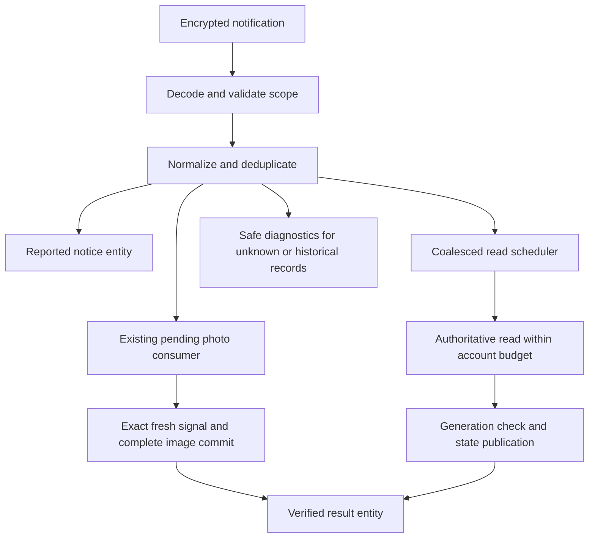

# Notification observability and automation

- Status: As-built implementation; final release and household evidence tracked separately
- Date: 2026-11-23
- Catalog capability ID: notification-observability-and-automation
- Last verified: deterministic core and real HA platform tests on 2026-11-23; no general non-photo delivery validation
- Owners: My Verisure maintainers
- Scope: normalized provider notices, verified outcomes, HA observability and bounded reconciliation
- Required review gates: behavior, architecture, privacy, concurrency, synthetic tests and controlled delivery evidence
- Evidence limits: actual entitlement/delivery of non-photo categories remains installation-specific; source-supported categories are not delivery guarantees

## 1. Executive summary

One entry-owned notification module admits and classifies provider messages, then
feeds photo completion, HA event projection and selective reconciliation. Two
EventEntities distinguish reported notices from verified outcomes. Diagnostic
sensors expose transport, binding, integrity and data freshness separately.
Existing polling, entity identities and manual alarm semantics remain intact.

## 2. Problem, current behavior and evidence

Before this capability, the receiver forwarded only to `PhotoNotifications`, which
requires a pending photo and `INF/type=0`. The official client has 22 explicitly
handled push requests plus navigation categories. This does not establish that
all categories are delivered to an independent HA receiver.

The [source catalog](../docs/validation/2026-11-23-notification-catalog.json) and
[audit](../docs/technical/notification-audit-and-design.md) separate client
support, official product descriptions, current code defects and actual HA
photo delivery. A notification's request, numeric transport type and activity
signal code are different contracts. Do not infer one from another.

## 3. Actors, surfaces and terminology

- **Provider notice:** an authenticated message reporting something, without
  automatically establishing current household state.
- **Verified outcome:** a fresh authoritative result or a completed local photo
  commit, with its verification method and correlation.
- **Notification module:** shared admission, normalization, deduplication and
  delivery lifecycle behind one interface; implementation remains HA-independent.
- **Installation/account/personal scope:** separate recipient contexts. A current
  selected installation never authorizes an unrelated workspace.
- **Occurrence/receipt:** provider event time and HA receive time. The former may
  be absent; HA EventEntity state records publication time.

## 4. Goals, non-goals and fixed invariants

- NOTIF-1: admit once, with bounded shape/size, sender, recipient scope and time checks.
- NOTIF-2: use a finite versioned event vocabulary; unknown messages remain observable without automatic provider work.
- NOTIF-3: publish reported notices and verified outcomes through separate HA EventEntities.
- NOTIF-4: preserve the pending-photo path and emit `photo_ready` only after complete persistence.
- NOTIF-5: perform only selective, coalesced, budgeted authoritative reads; retain ordinary polling.
- NOTIF-6: serialize commands and reject superseded reads before state publication.
- NOTIF-7: receiving a notification never arms/disarms, forces an operation, starts another capture, acknowledges an incident or changes provider configuration.
- NOTIF-8: preserve account, installation and workspace isolation across entries.
- NOTIF-9: restore display without replaying historical automation events; state delivery guarantees honestly.
- NOTIF-10: keep tokens, raw bodies, arbitrary links and private identifiers out of public event attributes/history/diagnostics.
- NOTIF-11: expose distinct health and loss counters; silence alone is not failure.
- NOTIF-12: validate durable crypto and preserve write ordering through cancellation and unload.
- NOTIF-13: preserve existing registry/device identities, native UUID and photo polling timing.
- NOTIF-14: preserve known local request context/correlation without inventing the actor, and prevent internal notification-feedback work from creating provider commands.

This capability does not create continuous PIR/contact telemetry from a timeline
code, infer physical presence from remote alarm activity, replace CRA emergency
handling, guarantee delivery, or authorize physical alarm tests. Interior total
remains excluded from agent live tests in this session.

## 5. Current versus intended journey

Text equivalent: decode and admit one scoped record, deduplicate before fan-out,
present the notice and let only documented consumers request verification.
Publish a verified result only when that verification completes. Unknown,
historical or ambiguous records never manufacture a state or initiate a command.

## 6. Functional behavior and state model

Implemented reported types are `photo_reported`, `alarm_operation_reported`,
`security_incident_reported`, `arm_reminder`, `unprotected_home`,
`smart_disarm_notice`, `device_maintenance_notice`, `device_tamper_reported`,
`maintenance_appointment`, `support_reply`, `account_notice`, `generic_notice`
and `unclassified_notice`. Implemented verified types are `photo_ready`,
`alarm_state_confirmed` and `incident_status_confirmed`. Additions require schema
and translation review; raw request strings never become unbounded event types.

Each immutable record has `schema_version`, local opaque `event_id` and
`correlation_id`, `kind`, `stage`, `category`, `scope`, `received_at`, optional
`occurred_at`, optional `verified_at`, `freshness`, `delivery` and `verification`.
Known provider request codes and unambiguous local HA entity references may be included. Provider
identifiers remain internal. Reported and verified records have distinct event
IDs and a shared correlation when established; correlation is never guessed.

`freshness` is `fresh`, `stale` or `unknown`. Missing provider time remains unknown.
The existing pending-photo timing checks remain unchanged. For ordinary timestamped
notices, the implemented live window is five minutes past and sixty seconds
future. Stale notices stay observational. A known, correctly scoped request with
missing provider time may mark one coarse resource reconciliation within the same
budget; an unknown request category never does. A freshly verified current state
can be useful even when its triggering notice lacks an occurrence timestamp.
These windows are local policy, with broader delivery evidence still required, not a
provider guarantee. Arrival order never proves causal or state order. Preserve
HA request context in the HA adapter when a local operation is actually known;
otherwise keep the cause unknown. Matching camera/time alone does not establish
which person or application initiated a request.

`delivery` is `live`, `buffered`, `restored` or `reconciled`; records with unknown
freshness may still support informational user notices, but never establish current security
state. Buffered/restored display does not invoke live EventEntity publication or
the optional public bus. Historical notices are inspectable through safe
diagnostics/history, with one grouped state reconciliation when appropriate.

Identical normalized state reads do not repeatedly publish a confirmed event.
An unsolicited `alarm_state_confirmed` represents an observed semantic change
from an established authoritative baseline. Initial baseline and outage recovery
update state/display with `delivery=reconciled`, without pretending the physical
change just happened. A live, locally correlated operation may also confirm its
result once. `verified_at` describes observation time, never an invented provider
occurrence time. Apply the same change/correlation rule to incident status.

Only a matching installation can enter that installation's live stream. Until
account/personal routing is verified, such messages remain safe unassigned
observations; do not assert a home event, expose location or accept invitations.

## 7. User-facing configuration

Implemented options, stored in entry options with validated booleans:

| Option | Default | Meaning |
|---|---|---|
| Existing `push_enabled` | false, unchanged | Enables the independent receiver and current photo completion |
| `notification_observation` | true | Projects safe reported/verified events and diagnostics; no new reads by itself |
| `push_state_refresh` | false during initial rollout | Opts into verified handlers' selective alarm/incident reads after prerequisite fixes |
| `external_photo_updates` | false | Permits exact-signal retrieval for photos originating outside HA; never creates captures |
| `advanced_event_bus` | false | Mirrors normalized records on `my_verisure_event` for advanced consumers |

Disabling observation leaves the established photo consumer and polling active.
Disabling push stops owned transport/consumers without unregistering phones or
discarding reusable private credentials. No option enables automatic provider
mutations. Arbitrary provider text is excluded from the initial public contract.
Extended content requires a separate privacy/retention design.

## 8. Clean Architecture design

Current seams: `core/api/push_receiver.py`, `core/application/photo_notifications.py`,
`push.py`, `coordinator.py`, `integration.py` and `diagnostics.py`.

Implemented ownership:

| Module | Interface and implementation responsibility |
|---|---|
| `core/api/notification_mapper.py` | Convert bounded provider shapes to typed notices; contain provider-specific field and request knowledge |
| `core/application/notifications.py` | Immutable record and entry-owned admission/fan-out; keep deduplication, scope, preparation and delivery semantics local |
| `core/application/notification_refresh.py` | Coalesce typed resource hints and request authoritative reads through a semantic interface |
| `core/api/provider_request_gate.py` | Account-shared admission, 403/429 cooldown and fair wire-request scheduling for all Verisure clients |
| `event.py` | Project the same records to two HA EventEntities; own entity subscribe/unsubscribe and restore behavior |
| Existing photo/coordinator adapters | Verify selected signals and state; publish verified outcomes at their actual commit points |

Core modules import no HA APIs. The composition root owns one notification module
per entry and the shared account gate reference. No callback exposes raw messages
to all consumers. Two consumers must not independently suppress each other by
mutating the same delivery ledger. Slow presentation or persistence cannot block
the pending-photo wake-up. Existing architecture checks remain required.

## 9. UI/UX and content contract

Localized labels: **Avisos**, **Resultados confirmados**,
**Conexión de notificaciones**, **Último aviso válido** and **Última verificación**.
Use stable entry-scoped unique IDs; displayed entity IDs are user-customizable.
Do not tie EventEntity availability to GraphQL freshness or socket connectivity.

Examples: “Nuevo aviso de mantenimiento”, “Foto disponible”, “Pendiente de
verificar”, “Receptor reconectando”, “Asociación con Verisure pendiente” and
“Consultas aplazadas por bloqueo temporal”. Localized template text explains
the observed condition without copying arbitrary provider text or claiming that
a connected socket proves all categories are delivered.

The primary automation surface is the native HA event-received trigger. A
verified-result example selects `photo_ready` with `freshness=fresh` and
`delivery=live`. State-dependent automations use confirmed state/outcomes;
informational reminders may use reported notices. The optional advanced bus
mirrors the same schema with entry identity; do not document both inputs for the
same action as if they were distinct occurrences.

## 10. Failure, recovery and cleanup

Fix cancellation-safe storage ownership and validate cached EC private/public
keys and authentication secret before relying on durable registration. If invalid,
surface degradation and use bounded recovery while retaining polling. Token
rotation has distinct registration, pending binding and accepted binding states;
commit device/profile changes transactionally and never loop SMS requests.

Keep at most 64 startup records / 128 KiB and a 100-record sanitized in-memory
diagnostic ring / 256 KiB. Bound delivery-ID replay storage to 512 hashes and a
24-hour horizon; report limits and their loss of older deduplication guarantees.
Overflow drops oldest presentation records and increments counters; it cannot
discard the direct wake-up for a valid active photo request. Drain/cancel all
entry-owned work and detach subscriptions before unload. Releasing one entry
must not cancel another entry's shared account gate.

FCM ACK, disk persistence and HA publication are not one transaction. No exactly-once
or complete historical replay guarantee is made. Use stable local IDs and
idempotent consumers; retain ordinary polling and reconcile current state once
after outages. No verified backfill endpoint is assumed.

## 11. Security, permissions and privacy

Project sender validation is necessary but does not establish installation
ownership. Apply field, recipient and authorized-service checks independently.
Never evaluate `advancedInfo`, follow supplied URLs, publish invocation tokens,
infer permissions from a deeplink or assign a personal-protection message to the
currently selected home. Invalid or unsupported envelopes produce only bounded
safe counters. Review SDK frame-size handling before broadening the ingestion surface.

EventEntity attributes enter HA Recorder, restore data and possibly backups.
Use allowlisted metadata and local templates. Keep crypto, FCM/account tokens,
raw provider identifiers, free text, GPS, invitation data and images out of public
records. Store any durable replay metadata privately, asynchronously and atomically.
The separate public Firebase configuration review remains applicable.

## 12. Observability and operations

Separate transport connected, registration valid, binding pending/accepted,
decode failure, last accepted notice and last authoritative state sync. Counters
distinguish received, accepted, duplicate, malformed, foreign scope, stale,
unclassified, overflow, persistence failure and deferred reconciliation. Quiet
time alone never changes health to failed. Cached state retains visible age.
Per-category coverage distinguishes source-known, entitlement-known/unknown,
delivery-observed and verification-supported; transport connection alone never
marks a category verified.

Implemented scheduler budget: a two-second grouping window, one pending job
per resource and at most one unsolicited reconciliation start per account per
30 seconds. A job does not license unlimited calls: every constituent request
passes account admission and current cooldown. Bound the resource queue to 32
keys; count overflow and discard excess new resources. Retain one dirty job per
admitted resource on a transient conflict or cooldown. Reconnection schedules one
coalesced state reconciliation when selective reads are enabled; it seeds the
baseline without replaying automation events. Explicit command completion takes priority; no gate lock is
held during polling sleeps. Existing photo fallback stays at 20 seconds.

All Verisure HTTP clients and entries sharing an account honor one cooldown,
including valid `Retry-After` on 429. No automatic mutation retry follows rejection.
Provider-origin admission also coordinates this HA process; a verified IP-wide
block applies across its affected entries. The gate cannot regulate external apps
sharing the IP. Security notices are visible immediately; their evidence-gathering reads remain within the same budget.

## 13. Compatibility, migration, rollout and rollback

Add `Platform.EVENT` without renaming the existing 20 household entities or native
UUID. Preserve the existing photo/profile/credential storage, migrating replay
ownership explicitly. Keep the FCM SDK pin reviewed with its adapter. The pinned
test target is HA 2026.8.1; controlled host evidence currently uses HA 2026.11.2.

Roll out inert observation before optional reads, then expand one verified
category at a time. A missing service or unavailable event entity must not break
photo completion. Rollback disables new consumers and preserves working receiver
credentials and state. Software rollback does not reverse a physical command.

## 14. Testing strategy and numeric budget

The original audit used 34 focused regressions and deterministic reproductions.
The implementation adds direct failure-to-pass regressions, complete source-family
mapping and real HA event/restore/lifecycle coverage. Final suite and production
branch coverage are recorded in [the implementation receipt](../docs/validation/2026-11-23-notification-implementation.json).
The historical 882-test/90% metric used a different coverage basis.

Risk-derived minimum for implementation: 42 distinct new acceptance cases,
which may be grouped with parametrization rather than 42 separate functions:

| Area | Minimum cases |
|---|---:|
| Crypto, registration/binding, cancellation and storage ordering | 8 |
| Schema, scope, freshness, unknowns, duplicate/replay and queue limits | 10 |
| Actual HA event projection, first event, restoration, availability and privacy | 8 |
| Account cooldown, 429, scheduling, command ordering and stale-result publication | 10 |
| Exact photo commit, external photo, incident entitlement and read-only behavior | 6 |

Use injected clocks, deterministic thread/events and fake transports. No test
contacts the household or Google. Run the existing complete suite and release
gates after code changes; a green baseline does not demonstrate the new contracts.

## 15. Documentation and discoverability

Maintain this implemented contract, [the audit](../docs/technical/notification-audit-and-design.md),
source/audit receipts, the capability catalog and the photo baseline together.
User configuration/entity docs and the [automation guide](../docs/automation-notifications.md)
include validated examples and a blueprint. Copilot tooling remains absent.

## 16. Acceptance scenarios

1. NOTIF-1/2/8: malformed, foreign, ambiguous and unknown input yields bounded
   diagnostics; no household state, navigation or provider request is inferred.
2. NOTIF-3/10: one accepted notice creates one safe reported event. Only actual
   verification creates its correlated confirmed result; raw private fields are absent.
3. NOTIF-4: a photo hint alone creates no `photo_ready`. Complete exact-signal
   persistence creates one; partial writes, wrong camera and old signals create none.
4. NOTIF-5/6: a burst and a concurrent command stay within admission; an older
   read cannot overwrite the newer command result. An unknown native code causes
   neither `CheckAlarm` nor a silent full refresh.
5. NOTIF-5/7: active cooldown means zero new wire requests across clients/entries;
   429 shares that policy. No incoming notice creates a mutation or new capture.
6. NOTIF-9: restore/reconnect does not replay historical automation; the first
   genuinely new event after reconnect is still observable. Dropped counts are visible.
7. NOTIF-11/13: cached data and an MCS connection do not advance authoritative
   freshness. Disabling an event entity does not disable photos or polling.
8. NOTIF-12: cancelling an old private write cannot replace newer durable state;
   malformed crypto is rejected locally and recovery remains bounded.
9. NOTIF-14: presenting a photo/maintenance event and sending a local HA notice
   creates zero Verisure requests. An unchanged state read creates no repeated
   semantic event; the optional bus is not a second independent interpretation.

## 17. Requirements traceability

| Requirements | Owner | Evidence / required validation |
|---|---|---|
| NOTIF-1/2/8 | mapper and notification module | source catalog; test_notification_admission.py and test_notification_contract_edges.py |
| NOTIF-3/9/10 | HA event adapter | real EventEntity restore/trigger tests; sanitized attribute assertions |
| NOTIF-4/13 | camera workflow and storage | existing photo tests plus post-commit event and migration cases |
| NOTIF-5/6/7 | account gate, command workflow, resource scheduler | test_notification_state_epochs.py, test_provider_request_gate.py, test_notification_refresh.py |
| NOTIF-11 | diagnostics and HA projection | precise counter semantics; transport/binding/cache distinctions |
| NOTIF-12 | receiver/private store | test_push_transport_recovery.py and test_push_receiver_replay.py |
| NOTIF-14 | notification module and HA adapter | local/unknown cause, single projection and feedback-loop tests |

## 18. Implementation or maintenance sequence

1. Fix and regression-test current admission, ordering, crypto and persistence defects.
2. Add typed admission, shared replay ownership and preparation lifecycle.
3. Add safe HA events/diagnostics without unsolicited provider reads; preserve photos.
4. Publish verified photo results at commit; add explicit native-state-only reads.
5. Enable opt-in resource reconciliation and validate one actual category at a time.
6. Extend permitted maintenance/account/personal categories and optional bus/history
   only with their own recipient, retention and entitlement evidence.

Each stage is independently reviewable and retains polling. No stage requires
provoking a real intrusion, power cut, tamper, SOS or interior-total activation.

## 19. Definition of Done

- [x] Current prerequisite defects have normal passing regressions.
- [x] Normalization, scope, replay, readiness and privacy contracts are implemented.
- [x] HA events, diagnostics, restore and isolation pass real platform tests.
- [x] Shared request admission and state ordering pass burst/concurrency tests.
- [x] Enabled handlers have scoped schema/verification tests and user docs; actual delivery coverage is explicitly identified.
- [x] Full gates pass; original identities/token survive restart/reload and a real photo confirms the event path. Polling remains enabled.

## 20. References and decisions

Primary sources are indexed in the source receipt. Related baselines:
[Linux photo push](linux-push-photo-completion.md),
[alarm commands](alarm-modes-and-confirmation.md),
[native authentication](native-authentication-and-session-lifecycle.md) and
[camera identity](installation-cameras-and-entity-identity.md).
The recommendation favors two EventEntities over a raw payload sensor or one
entity per provider code. Recorder supplies normal history; independent raw
message storage is not a prerequisite. The optional bus is a mirror, not a
second semantic stream. These decisions are implemented; general non-photo delivery remains evidence-driven.
