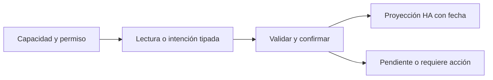

# Conéctame, servicios personales y funciones propias del móvil

- Status: Draft
- Date: 2026-11-24
- Catalog capability ID: personal-protection-and-native-services
- Last verified: 2026-11-24, investigación y diseño; implementación futura
- Owners: My Verisure maintainers
- Scope: servicios basados en SDK/permisos del dispositivo y equivalentes útiles en HA
- Required review gates: behavior, architecture, testing, documentation, security/operations
- Open decisions blocking readiness: protocolos SDK y licencias/consentimientos por persona; datos de origen y frescura de ubicación; autorización legítima, dependencia de hardware y diferencias iOS/Android/macOS

## 1. Executive summary

Evaluar funciones nativas con su ámbito y dependencias reales. La integración Linux puede observar servicios autorizados o aprovechar sus eventos, pero no fingir que es un teléfono con GPS, sensores, biometría o un protocolo de emergencia operativo.

Se aplica íntegramente la [base común de gestión](app-management-foundation.md), especialmente permisos, admisión, privacidad, confirmación y aislamiento.

## 2. Problem, current behavior and evidence

Conéctame apareció en ajustes nativos y no en los ajustes observados de Chrome. Se inspeccionaron buzón, configuración de app y perfil/terminal. El puente define unprotectedHome, guardian/redButton/walkWithMe, families, carCrash, biometría, permisos y preferencias. La ayuda oficial describe Guardián/familia; su disponibilidad no se comprobó como servicio activo en este Mac.

La [auditoría](../docs/technical/2026-11-24-app-capability-audit.md) y el [inventario de operaciones](../docs/validation/2026-11-24-app-capabilities.json) separan fuente estática, UI nativa/web y consultas observadas. Este SDD no declara nuevas funciones instaladas.

## 3. Actors, surfaces and terminology

Instalación, cuenta, persona protegida, círculo familiar y dispositivo son ámbitos distintos. Conéctame avisa de desprotección; no es una orden para armar. Un evento de cuenta no se asigna a una vivienda por defecto.

Actores: usuario HA autorizado, principal/rol Verisure, recurso de la cuenta o instalación y adaptadores HA/CLI. La visibilidad de un menú no otorga permisos de backend.

## 4. Goals, non-goals and fixed invariants

- NATIVE-1 — **Conéctame:** Permitir lectura acotada de configuración/estado si el servicio lo autoriza; no activar geofencing ni simular localización del móvil al iniciar HA.
- NATIVE-2 — **Presencia voluntaria:** Ubicación/familias sólo opt-in con permiso, identidad y frescura; nunca deducir presencia física de una conexión/desconexión de alarma.
- NATIVE-3 — **Emergencias:** SOS, cuenta atrás, Acompáñame, red button y car crash no se originan ni cancelan automáticamente desde HA; conservar la vía oficial hasta un proyecto independiente validado.
- NATIVE-4 — **Hardware y SDK:** Distinguir contrato de bridge de endpoint remoto; no prometer escaneo Wi-Fi, reloj, actividad o biometría desde un host Linux.
- NATIVE-5 — **Preferencias locales:** Usar equivalentes HA para confirmación/voz/presentación cuando proceda, sin cambiar preferencias del teléfono; no automatizar consentimientos de analítica/publicidad.
- NATIVE-6 — **Servicios y tokens:** Separar licencias, usuarios, tokens/capacidades de protección personal de la sesión/instalación de alarma.
- NATIVE-7 — **Eventos con ámbito:** Publicar sólo metadatos seguros y alcance conocido; no inventar instalación para un evento de cuenta/persona.
- NATIVE-8 — **Fallo y consentimiento:** Deshabilitar la presentación de datos que pierdan permiso o frescura y no reactivar servicio, suscripción o permisos tras restauración.

Las pruebas domésticas mantienen la prohibición de interior total. No se realizan compras, emergencias o actuaciones físicas por inferirlas de una notificación.

## 5. Current versus intended journey

Equivalente: permiso del recurso → lectura/intención concreta → validación y confirmación → representación HA. Si falta contrato, permiso o resultado, no se publica un éxito. El estado actual es investigación; la implementación seguirá esta separación.

## 6. Functional behavior and state model

| Función | Referencia | Encaje HA |
|---|---|---|
| Conéctame | mkGetUnprotectHomeConf; RPC unprotectedHome.checkService/activeService/deactiveService | lectura/eventos condicionados; setter SDK sin contrato Linux validado |
| Guardián/Acompáñame | mkGuardian, mkAccompanying; RPC redButton/walkWithMe | observar sólo si está permitido; actuación de emergencia fuera de esta ampliación |
| Familias/relojes | Families*, servicios/licencias/invitaciones y RPC families | tracker opcional sólo con autorización y datos legítimos |
| Accidente/actividad | CarCrash y permisos del dispositivo | dependencia de sensores móviles; no equivalente servidor |
| Voz/confirmación | preferencias nativas TTS/confirmación | automatizaciones HA con textos locales seguros e intención explícita |
| Sesión/biometría | device/session/biometricSecurity | auth HA y baseline de persistencia; no copiar la identidad biométrica del móvil |
| Tienda/compartir/contactos | internet/device/campaigns | navegación/acción humana, sin pedidos ni mensajes automáticos |

Un recurso personal se descubre por servicio/rol, se autoriza y se observa con fecha/permiso propios. Si falta SDK o fuente verificada, la capacidad queda condicionada, sin entidad operativa. Para Conéctame, un mapa con coordenadas no se replica en atributos genéricos. Una futura integración de trackers requiere un contrato de privacidad y ámbito independiente de la alarma.

Para familias, evaluar por separado usuarios/dispositivos, círculos, roles,
invitaciones, lugares y alertas de entrada/salida. Sus altas/bajas/ediciones son
administración privada condicionada a permiso y confirmación, no descubrimiento
automático ni sincronización bidireccional implícita con personas/zonas HA.
`xSSendFamiliesSilentPushesCircleLocations` solicita trabajo a dispositivos: no
se convierte en polling continuo de ubicación. El rechazo de una invitación o un
consentimiento no dispara otra invitación ni una nueva autorización.

Aplicar estados unknown/stale/pending/confirmed/partial/ambiguous según la base común. Un resultado antiguo, duplicado o cancelado no sustituye hechos más recientes.

## 7. User-facing configuration

Todo desactivado por defecto. Selección explícita de servicio/persona y tipos de datos; sin importación automática de todos los contactos o círculos. Un ejemplo HA de voz usaría eventos seguros y el motor TTS elegido por el usuario, no el cuerpo libre del push ni cambios en la app nativa.

## 8. Clean Architecture design

Puertos separados `UnprotectedHomeRepository`, `PersonalProtectionRepository` y `AuthorizedPresenceRepository`; SDKs/transportes en adaptadores opcionales. No introducir dependencias iOS/Android en el core ni registrar un teléfono ficticio para acceder a funciones. HA device_tracker sólo tras contrato/frescura probados.

La identidad técnica del receptor FCM existente no acredita GPS, sensores móviles,
licencias personales ni autorización de alta seguridad. Se conserva ese receptor
sin atribuirle capacidades de teléfono que no tenga.

Las rutas y tipos anteriores son propuestas. Reutilizar el grafo por entrada, las sesiones, el gate de proveedor y los mecanismos de publicación existentes. Extender el guardián de arquitectura y comprobar importaciones sin HA.

## 9. UI/UX and content contract

Mostrar «Requiere el móvil», «Servicio no contratado», «Sin permiso», «Ubicación antigua» y la diferencia entre cuenta/persona/vivienda. Enlaces oficiales para funciones excluidas; no botones de emergencia aparentemente operativos sin aceptación independiente.

Etiquetas accesibles, localización y controles equivalentes en móvil/escritorio. Las acciones propuestas aún no existen en la versión instalada.

## 10. Failure, recovery and cleanup

Permiso revocado o SDK no disponible: conservar el motivo, caducar datos y detener lecturas. Nunca actualizar una ubicación con la hora de recepción como si fuera una medición nueva. No cancelar un trayecto real como cleanup de HA.

Unload cancela seguimiento y drena persistencia; no equivale a deshacer la operación remota. Limpiar temporales propios conservando hechos confirmados y evidencia privada mínima.

## 11. Security, permissions and privacy

Datos de localización, teléfonos, invitaciones y tokens personales privados. La condición de titular del inmueble no basta para ampliar acceso a todos los servicios/personas. No aceptar términos ni nuevos permisos en background.

Se aplican controles de ámbito/rol vigentes y autorización explícita de automatizaciones de APP-6/7. Fixtures sintéticas; ningún secreto, dirección, identificador doméstico o captura HAR se incorpora al repositorio.

## 12. Observability and operations

Lectura voluntaria y acotada; sin heartbeats de ubicación fabricados ni seguimiento intensivo. Separar cuotas de servicio personal de alarma manteniendo cooldown por origen cuando corresponda. No usar la instalación doméstica para ensayar emergencias.

Registrar duración, resultado y motivo local; sin mensajes arbitrarios del proveedor. Los presupuestos comunes son propuestas sujetas a medición, no límites oficiales.

## 13. Compatibility, migration, rollout and rollback

Habilitación por entrada y capacidad, primero lecturas, después escrituras manuales autorizadas. Preservar UUID, FCM, credenciales, unique_id y automatizaciones existentes. Eliminar/desactivar soporte local no modifica recursos remotos. Rollback mantiene snapshots privados versionados y deja las funciones incompatibles desactivadas.

## 14. Testing strategy and numeric budget

32 casos: ocho riesgos por cuatro variantes, incluyendo identidad/servicio cruzado, ubicación caducada, SDK ausente, consentimiento revocado, evento sin instalación y restauración sin actuar.

Son mínimos propuestos para la futura implementación, no tests ya escritos ni cobertura medida. Usar relojes/repositorios/HTTP falsos y cero llamadas domésticas en CI; exigir 100% de líneas/rama en políticas críticas y constructores de mutaciones nuevos y respetar los gates del proyecto.

## 15. Documentation and discoverability

Mantener este SDD, [CATALOG.md](CATALOG.md), el inventario de operaciones y la auditoría. La futura implementación añadirá guía específica, acciones, permisos, migración y ejemplos con valores ficticios. No anunciar la capacidad como disponible antes de su aceptación.

## 16. Acceptance scenarios

| Requisito | Given / When / Then resumido |
|---|---|
| NATIVE-1 | Se descubre Conéctame; no se conceden permisos de ubicación ni se activa el servicio. |
| NATIVE-2 | La alarma cambia a armado; no se crea un hecho de persona fuera de casa. |
| NATIVE-3 | Llega un aviso de cuenta; no dispara una llamada ni inicia/cancela protocolo de emergencia. |
| NATIVE-4 | Sólo existe comando nativo de permiso; se informa dependencia del móvil sin fabricar respuesta exitosa. |
| NATIVE-5 | Se configura una notificación HA; la preferencia de voz o publicidad de la app permanece igual. |
| NATIVE-6 | Un token de alarma existe; no autoriza leer círculos o actuar otro servicio. |
| NATIVE-7 | Un aviso familiar carece de instalación; no actualiza el panel de la vivienda por coincidencia. |
| NATIVE-8 | Se revoca una autorización; el tracker queda no disponible y no se reinscribe el dispositivo. |

Cada escenario se descompone en variantes de tipos, autorización, error, concurrencia y recuperación según el presupuesto. La validación física requiere autorización concreta independiente.

## 17. Requirements traceability

| ID | Riesgo/función | Verificación futura | Responsable de implementación |
|---|---|---|---|
| NATIVE-1 | Conéctame | Caso de aceptación NATIVE-1; matriz sintética de §14 | Política/caso de uso y adaptador descritos en §8 |
| NATIVE-2 | Presencia voluntaria | Caso de aceptación NATIVE-2; matriz sintética de §14 | Política/caso de uso y adaptador descritos en §8 |
| NATIVE-3 | Emergencias | Caso de aceptación NATIVE-3; matriz sintética de §14 | Política/caso de uso y adaptador descritos en §8 |
| NATIVE-4 | Hardware y SDK | Caso de aceptación NATIVE-4; matriz sintética de §14 | Política/caso de uso y adaptador descritos en §8 |
| NATIVE-5 | Preferencias locales | Caso de aceptación NATIVE-5; matriz sintética de §14 | Política/caso de uso y adaptador descritos en §8 |
| NATIVE-6 | Servicios y tokens | Caso de aceptación NATIVE-6; matriz sintética de §14 | Política/caso de uso y adaptador descritos en §8 |
| NATIVE-7 | Eventos con ámbito | Caso de aceptación NATIVE-7; matriz sintética de §14 | Política/caso de uso y adaptador descritos en §8 |
| NATIVE-8 | Fallo y consentimiento | Caso de aceptación NATIVE-8; matriz sintética de §14 | Política/caso de uso y adaptador descritos en §8 |

Tests propuestos: `test_native_capability_policy.py, test_personal_service_scope.py, test_authorized_presence.py, test_unprotected_home_observation.py`. Son nombres de trabajo futuros, sin atribuirles ejecución actual. La evidencia disponible está en §2/6; los bloqueos del encabezado deben cerrarse antes de Ready for implementation.

## 18. Implementation or maintenance sequence

Revisar contratos y bloqueos → modelos/puertos semánticos → casos de uso con fakes → matriz de errores/privacidad → adaptador proveedor → presentación HA/CLI → compatibilidad/migración → lecturas controladas → escrituras concretas autorizadas cuando apliquen → rollout. No usar una prueba física peligrosa para completar una matriz sintética.

## 19. Definition of Done

- [ ] Requisitos y escenarios trazados; bloqueos de protocolo/permiso resueltos.
- [ ] Contratos por panel/hardware y confirmación comprobados.
- [ ] Tests, cobertura crítica, aislamiento, cancelación y privacidad verificados.
- [ ] Migración, rollback, guías y catálogo actualizados.
- [ ] Evidencia UI, sintética y física separadas, con sus límites publicados.

## 20. References and decisions

[Guardián y familia](https://www.verisure.es/cliente/servicios) · [Protocolo oficial](https://www.verisure.es/cliente/protocolo-emergencia) · [Configuración y Conéctame](https://www.verisure.es/cliente/configuracion-sistema)

[Base común](app-management-foundation.md) · [Norma de SDDs](README.md) · [Decisión de dependencias](../docs/adr/0001-core-and-adapter-dependencies.md). Estado Draft: la elección de exposiciones HA es una recomendación de diseño, no un comportamiento observado del proveedor.
