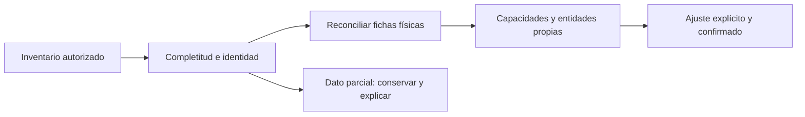

# Inventario físico completo y dispositivos de Home Assistant

- Status: Draft
- Date: 2026-11-24
- Catalog capability ID: physical-device-inventory
- Last verified: 2026-11-24, UI, código y diseño; implementación futura
- Owners: My Verisure maintainers
- Scope: todos los dispositivos físicos de la instalación, información, jerarquía, identidad, nombres y migración del registro HA
- Required review gates: behavior, architecture, testing, documentation, security/operations
- Open decisions blocking readiness: identidad autoritativa por familia/panel, completitud de inventario y compatibilidad de targets/device automations al separar cámaras del hub existente

## 1. Executive summary

Cada dispositivo físico listado por Verisure debe tener una representación en el
registro de dispositivos de HA al habilitar esta ampliación. Esto incluye panel,
fotodetectores, contactos de acceso, perimetrales, lector y sirena; otros tipos se
descubren sin una lista cerrada que los descarte. Un recurso sin telemetría puede
tener ficha de inventario sin inventar entidades de movimiento, apertura o batería.

La [base común](app-management-foundation.md) gobierna permisos y ciclo de vida;
[ajustes](installation-and-device-settings.md) gobierna cambios remotos. Este SDD
añade la proyección física que no describía suficientemente la baseline de cámaras.

## 2. Problem, current behavior and evidence

La revisión nativa recorrió el listado completo y fichas representativas de panel,
lector, sirena, contacto y perimetral; el fotodetector se contrastó con la revisión
web anterior y las capturas proporcionadas por el usuario. Distintos dispositivos
comparten alias, lo que impide usar nombres como identidad. Las fichas ofrecen
información descriptiva y controles diferentes según la familia.

En 1.1.0, `device.py:get_device_info` y `async_setup_device` registran el hub por
entrada. `camera.py` asocia también sus cámaras a ese hub. Tener la lista completa
en `DeviceList` no equivale a registrar cada pieza física en HA. Esto es una
carencia funcional a cubrir; no se modifica ese código en esta entrega documental.

La [matriz de pantallas](../docs/technical/2026-11-24-configuration-screen-audit.md)
distingue lo observado de contratos sin probar y no publica alias domésticos.

## 3. Actors, surfaces and terminology

Instalación y hub lógico, panel físico, dispositivo físico, entidad HA, función
configurable y observación son conceptos distintos. Un contacto puede tener
programa día/noche y timbre sin que la API publique su apertura en tiempo real.
Una sirena física no demuestra que exista una API para hacerla sonar a voluntad.

`provider_alias` es el nombre remoto; `name_by_user`, área, etiquetas y nombres
de entidades son personalización HA. El usuario puede mantener nombres distintos.

## 4. Goals, non-goals and fixed invariants

- INV-1 — **Inventario completo:** Registrar todos los recursos físicos inequívocos de la entrada; no filtrar por cámara, `remoteUse` o actividad. Ausencia de esas capacidades limita acciones, no borra la ficha.
- INV-2 — **Identidad y jerarquía:** Resolver identidad estable por instalación/familia/recurso y referencia opaca local; asociar al hub/panel correcto sin duplicar el panel ni mezclar entradas con alias/códigos iguales.
- INV-3 — **Información fiel:** Preservar tipo, modelo y estado sólo cuando estén demostrados; tipos nuevos permanecen en inventario con información genérica y sin controles inventados.
- INV-4 — **Entidades por capacidad:** Asociar fotos, configuración y diagnóstico al dispositivo correcto; no fabricar apertura, movimiento, porcentaje de pila, audio o conectividad a partir de descripciones comerciales o presencia en el listado.
- INV-5 — **Nombres independientes:** Renombrar remotamente requiere una acción explícita y confirmada; cambiar el nombre local de HA no llama a Verisure ni sobreescribe `name_by_user`, áreas o etiquetas al refrescar.
- INV-6 — **Reconciliación segura:** Una lista parcial, KO, timeout o una omisión aislada no elimina dispositivos/entidades. Las altas son idempotentes; una baja necesita evidencia autoritativa y una política local revisada.
- INV-7 — **Migración compatible:** Preservar hub, `entity_id`, `unique_id`, historial y personalizaciones. Resolver targets por dispositivo y automatizaciones antes de reasociar entidades existentes; no prometer compatibilidad sólo porque su entity_id no cambia.
- INV-8 — **Aislamiento y privacidad:** No publicar IDs del proveedor, seriales, ubicación o rutas privadas como atributos; mutaciones y detalles privados verifican entrada/recurso/permiso, también tras renombrar o reemplazar hardware.

Esta especificación no autoriza alta física, emparejamiento, compra, eliminación
remota ni armado interior total. Las llaves personales y miembros de familias
tienen sus propios SDDs; no se convierten automáticamente en aparatos de la casa.

## 5. Current versus intended journey

Equivalente: leer el inventario de la entrada → validar cobertura e identidad →
crear/actualizar fichas → asociar sólo funciones demostradas → administrar por
intención explícita. Un inventario parcial conserva las fichas conocidas.

## 6. Functional behavior and state model

| Familia observada | Ficha HA propuesta | Funciones adicionales condicionadas |
|---|---|---|
| Unidad central/panel | Panel vinculado al hub existente, sin duplicación física | Red, tiempos y diagnóstico; lectura/configuración según panel |
| Fotodetector | Dispositivo propio y cámara existente asociada de forma compatible | Foto explícita y participación independiente día/noche |
| Contacto de acceso/Shocksensor | Dispositivo propio y metadatos | Participación día/noche y timbre si se admiten; apertura en vivo no demostrada |
| Perimetral | Dispositivo exterior y cámara si hay capacidad de foto | Participación exterior fija observada; no ofrecer editor día/noche por analogía |
| Lector de llaves | Dispositivo propio y alias | Flags/PIN sólo si realmente admitidos; no se observaron esos controles en su ficha |
| Sirena | Dispositivo propio y alias | No crear una entidad `siren` actuable sin endpoint/permiso específico |
| Familia futura/desconocida | Ficha genérica con identidad validada | Sin controles hasta descubrir contrato y capacidad positivos |

Las variantes `xSDeviceList` no seleccionan los mismos campos: algunas sólo tipo,
otras nombre/tipo, otras identidad/configuración. El adaptador debe escoger un
inventario autoritativo completo; no alimentar el registro con una selección
parcial o filtrada como si acreditase una baja. La lista detallada ya usada por
el core se reutiliza cuando cumple ese contrato, sin una consulta por entidad.

Estados de observación: conocido/vigente, desconocido, antiguo, ausente de una
lista parcial y retirada confirmada. El cambio de alias o de orden no cambia la
identidad. Si se reutiliza un código para hardware nuevo, no unirlo por alias:
resolver evidencia de reemplazo o declarar conflicto y pedir intervención.

## 7. User-facing configuration

Al habilitar el inventario físico, registrar todas sus familias automáticamente.
Las escrituras de ajustes continúan con su habilitación y permisos separados.
Mostrar nombre, familia, funciones admitidas y antigüedad; el dato desconocido
tiene motivo visible. Una ficha sin entidades debe seguir apareciendo en HA.

Proponer `text` de configuración para el alias remoto cuando el contrato/permiso
lo permita. El cambio local de nombre en HA conserva su semántica normal. No
sincronizar ambas direcciones por defecto ni inferir área a partir del alias.

## 8. Clean Architecture design

Modelos puros propuestos: `PhysicalDevice`, `DeviceIdentity`, `InventorySnapshot`
(cobertura/fecha/generación), `DeviceCapabilities` y `InventoryReconciliation`.
Puerto `DeviceInventoryRepository`; caso de uso `ReconcileDeviceInventory` sin
importar HA. Las políticas de completitud, identidad y reemplazo permanecen puras.

Adaptador futuro `device_inventory.py` fuera del core registra fichas mediante
`device_registry.async_get_or_create`; actualiza metadatos propios y relaciones
`via_device_id` de HA Core 2026.11.2. No usar la API de child devices para ocultar
sensores físicos independientes como partes lógicas del panel. El core no conoce
DeviceInfo, registros HA, GraphQL ni filesystem. Extender el guardián de arquitectura.

## 9. UI/UX and content contract

La ficha diferencia «Nombre en Verisure» y «Nombre en Home Assistant». Una edición
remota muestra pendiente/confirmada/ambigua con el recurso inequívoco. En recursos
sin telemetría, mostrar «Inventariado; estado instantáneo no disponible». Nunca
mostrar «cerrado», «sin movimiento» o «pila llena» por el mero descubrimiento.

## 10. Failure, recovery and cleanup

Un fallo conserva inventario previo con antigüedad. Un fallo de asociación al
registro local se reintenta idempotentemente sin consultas remotas adicionales.
Unload cancela tareas y drena persistencia propia. Rehabilitar la familia no
duplica dispositivos. Retirar localmente una ficha no borra el aparato en Verisure.

## 11. Security, permissions and privacy

Resolver referencias locales y sesión/instalación vigentes antes de actuar. No
aceptar un `device_id` de otra entrada o usar un alias como selección autorizada.
Guardar el mapa de identidad privado y versionado; no exponer su clave proveedor.
Los nombres que el usuario elija mostrar no habilitan publicar más datos privados.

## 12. Observability and operations

Contadores seguros: fichas creadas/actualizadas, conflictos, cobertura incompleta
y cambios descartados por generación. Reutilizar el snapshot de descubrimiento;
no hacer lecturas radio de cada dispositivo al arrancar o renderizar su ficha.
Las consultas de ajuste individuales siguen los presupuestos de la base común.

## 13. Compatibility, migration, rollout and rollback

Primero probar el registro con fixtures y ofrecer fichas nuevas sin mover nada;
después revisar una migración por entrada de las cámaras ya existentes. Preservar
hub y datos de registro, incluso nombres duplicados, áreas y entidades deshabilitadas.
Sólo reasociar cuando la identidad sea inequívoca y los targets antiguos conserven
comportamiento compatible, o exista una migración explícita revisada antes del rollout.

La representación física de la central puede reutilizar el hub si corresponde de
forma inequívoca; si éste sigue siendo lógico, enlazar una ficha física separada
explicando ambas funciones. Esta decisión debe cerrarse por panel antes de Ready.
Rollback conserva el mapa local y no cambia configuración, FCM ni recursos remotos.

## 14. Testing strategy and numeric budget

Mínimo futuro: **32 casos**, ocho familias de riesgo por cuatro variantes:
inventario completo/parcial, alias duplicados/códigos reutilizados, tipo desconocido,
ausencia de telemetría, nombre remoto/local, altas/bajas/reinicio, migración de
targets y aislamiento/privacidad. Incluir registro sin entidades, recursos inactivos
y `remoteUse=None/false`, listas reordenadas y conservación de cámaras existentes.

CI usa datos sintéticos y registros HA reales del entorno fijado, sin proveedor.
Exigir cobertura completa de nuevas políticas críticas y las puertas vigentes;
estos casos son futuros y no constituyen cobertura medida actual.

## 15. Documentation and discoverability

Mantener catálogo, matriz de pantallas, inventario de contratos y guía futura de
dispositivos/renombrado. Separar funciones presentes de propuestas. Documentar
cómo localizar una ficha sin entidades y qué implica su falta de telemetría.

## 16. Acceptance scenarios

| Requisito | Given / When / Then |
|---|---|
| INV-1 | Lista sintética con seis familias, recursos inactivos y sin remoteUse; se habilita; todos los físicos válidos tienen ficha, incluso sin entidades. |
| INV-2 | Dos aparatos tienen el mismo alias y dos entradas comparten códigos; se descubren; quedan separados y vinculados a su instalación. |
| INV-3 | Aparece una familia nueva con modelo null; se reconcilia; se conserva como genérica sin inventar modelo ni descartarla. |
| INV-4 | Un contacto sólo ofrece alias/programa; se proyecta; no aparece una apertura en tiempo real ficticia. |
| INV-5 | El usuario puso nombre y área locales; cambia el alias remoto; se verifica y actualiza sin sobrescribir esas personalizaciones. |
| INV-6 | Una selección sólo devuelve fotodetectores; se recibe; no se eliminan contactos, sirena o perimetrales conocidos. |
| INV-7 | Una cámara existente tiene automatizaciones/targets; se migra; IDs, historial y comportamiento de los targets preservados se verifican antes de reasociar. |
| INV-8 | Un cambio remoto usa referencia de otra entrada; se solicita; se rechaza antes de HTTP y no se registran datos privados. |

## 17. Requirements traceability

| ID | Implementación propuesta | Verificación futura |
|---|---|---|
| INV-1 | Caso de uso de inventario y adaptador de registro | Escenario INV-1; `test_physical_device_registry.py` |
| INV-2 | Política de identidad/jerarquía | Escenario INV-2; `test_device_inventory_identity.py` |
| INV-3 | Mapeo de familias/metadatos | Escenario INV-3; `test_device_inventory_projection.py` |
| INV-4 | Política de capacidades | Escenario INV-4; `test_device_inventory_projection.py` |
| INV-5 | Alias y proyección de nombre | Escenario INV-5; `test_remote_alias_preservation.py` |
| INV-6 | Reconciliación/completitud | Escenario INV-6; `test_device_inventory_reconciliation.py` |
| INV-7 | Migración y resolución de targets | Escenario INV-7; `test_physical_device_migration.py` |
| INV-8 | Permisos/privacidad por recurso | Escenario INV-8; `test_device_inventory_scope.py` |

Los nombres anteriores son archivos futuros. La evidencia actual es UI, fuente
y revisión del código; no pruebas ejecutadas de esta nueva capacidad.

## 18. Implementation or maintenance sequence

Resolver identidad/completitud → políticas y fixtures → registro de todas las
familias → presentación sin telemetría inventada → revisión de migración/targets
→ alias y configuración por capacidad → rollout de lectura → acciones autorizadas.

## 19. Definition of Done

- [ ] Inventario completo por panel y registro sin entidades comprobados.
- [ ] Identidad, alias locales/remotos, reemplazos y parcialidad probados.
- [ ] Migración de cámaras, targets e historial aceptada antes de habilitarla.
- [ ] Cobertura crítica, arquitectura, privacidad, docs y rollback verificados.
- [ ] Ninguna función declarada disponible sólo por existir una ficha física.

## 20. References and decisions

[Auditoría global](../docs/technical/2026-11-24-app-capability-audit.md) ·
[Baseline actual](installation-cameras-and-entity-identity.md) ·
[Registro oficial HA](https://contributors.home-assistant.io/core/integrations/device-registry/) ·
[Fuente HA Core 2026.11.2](https://github.com/home-assistant/core/blob/2026.11.2/homeassistant/helpers/device_registry.py).
La API se contrastó con el paquete local de esa versión; la guía web puede avanzar
con el tiempo. Estado Draft: no hay nueva representación física instalada todavía.
