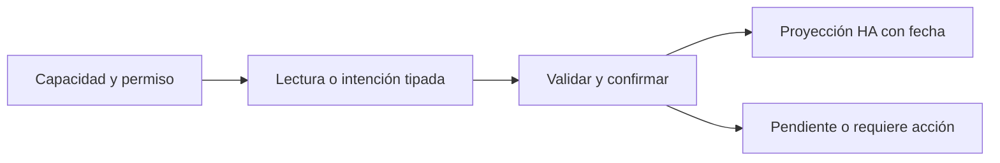

# Planes de acción, administración protegida y documentación de cuenta

- Status: Draft
- Date: 2026-11-24
- Catalog capability ID: protected-account-administration
- Last verified: 2026-11-24, investigación y diseño; implementación futura
- Owners: My Verisure maintainers
- Scope: contactos, planes, credenciales, terminales, documentación y operaciones administrativas de alto impacto
- Required review gates: behavior, architecture, testing, documentation, security/operations
- Open decisions blocking readiness: propósito y vinculación de cada desafío seguro, prueba del dispositivo y reutilización legítima en Linux; validación por rol de planes/credenciales; exportación de documentos y confirmaciones de cada flujo

## 1. Executive summary

Separar información administrativa útil de cambios protegidos o contractuales. Favorecer lecturas mínimas y flujos interactivos; compras, cambios de titular/contrato y consentimiento se mantienen en la interfaz oficial.

Se aplica íntegramente la [base común de gestión](app-management-foundation.md), especialmente permisos, admisión, privacidad, confirmación y aislamiento.

## 2. Problem, current behavior and evidence

Se inspeccionaron Mi instalación y el perfil nativo, incluido el acceso a terminales autorizados. La app ofreció autorizar el terminal por separado del login; no se autorizó. La ayuda explica planes, palabras clave, roles y terminales. Los contratos estáticos incluyen OTP seguro, contactos, facturas y datos de cuenta.

La [auditoría](../docs/technical/2026-11-24-app-capability-audit.md) y el [inventario de operaciones](../docs/validation/2026-11-24-app-capabilities.json) separan fuente estática, UI nativa/web y consultas observadas. Este SDD no declara nuevas funciones instaladas.

## 3. Actors, surfaces and terminology

Login, autorización de terminal, confirmación de acción, PIN, contraseña y palabra de coacción no son equivalentes. Plan de acción del inmueble, vacaciones y protección personal tienen ámbitos distintos.

Actores: usuario HA autorizado, principal/rol Verisure, recurso de la cuenta o instalación y adaptadores HA/CLI. La visibilidad de un menú no otorga permisos de backend.

## 4. Goals, non-goals and fixed invariants

- ADMIN-1 — **Ámbitos y contactos:** Consultar/editar planes en su ámbito exacto y conservar orden, relación y fin de vacaciones; no mezclar contactos de protección personal e inmueble.
- ADMIN-2 — **Acción segura:** Vincular challenge a intención/recurso/sesión y caducidad; no autorizar terminales ni ejecutar confirmaciones sólo por haber iniciado sesión.
- ADMIN-3 — **Secretos:** No exponer PIN, contraseñas ni palabras clave/coacción como entidades o atributos; usar flujo privado o redirigir a la app oficial.
- ADMIN-4 — **Actualización concurrente:** Aplicar cambios sobre datos vigentes y comprobar confirmación; cambios de contactos/códigos no se deshacen automáticamente tras un fallo local.
- ADMIN-5 — **Documentación:** Facturas, contrato e informes sólo se descargan por petición explícita y permiso; validar tamaño, tipo, host y caducidad, sin enlace público persistente.
- ADMIN-6 — **Legal y comercio:** No automatizar consentimiento GDPR/publicidad, suscripciones, pagos, traslado o cambio de titular; ofrecer ruta oficial apropiada.
- ADMIN-7 — **Bajas y revocaciones:** No vincular uninstall/unload con borrar usuarios, desvincular instalaciones o revocar dispositivos; esas acciones tienen flujo independiente.
- ADMIN-8 — **Acceso administrativo:** Exigir autorización HA y proveedor para lecturas sensibles y escrituras; un contexto sin usuario o un rol desconocido no concede privilegios.

Las pruebas domésticas mantienen la prohibición de interior total. No se realizan compras, emergencias o actuaciones físicas por inferirlas de una notificación.

## 5. Current versus intended journey

Equivalente: permiso del recurso → lectura/intención concreta → validación y confirmación → representación HA. Si falta contrato, permiso o resultado, no se publica un éxito. El estado actual es investigación; la implementación seguirá esta separación.

## 6. Functional behavior and state model

| Área | Referencias | Tratamiento propuesto |
|---|---|---|
| Planes | mkActionPlans, mkUpdatePlan, LongTermPlan | permiso y ámbito; no confundir nombre genérico con instalación única |
| Cuenta/contacto | InstallationFullData, CommunicationData/SrvCommData, cambios de nombre/contacto | mínimo necesario; lecturas privadas |
| Seguridad | GetTrustedDevices, mkConfirmSecureAction, variantes OTP y cambio de contraseña | flujo protegido sin suponer equivalencia entre hashes |
| Documentos | mkInvoiceList/mkInvoice, ContractInfo, certificación | descarga privada explícita o enlace oficial |
| Contrato/comercio | vinculación, traslado, titularidad, pagos, StandAlone*, términos | interfaz oficial; sin acción automática HA |
| Privacidad/campaña | GDPRData/UpdateGdpr, campañas/valoraciones | no alterar consentimiento ni automatizar marketing |

Clasificar una petición como lectura privada, cambio administrativo protegido o actuación que debe permanecer en la app. Si el protocolo seguro no está validado, el flujo termina con acción requerida y enlace oficial; no reproduce credenciales del móvil ni genera firmas falsas. Los contactos se muestran sólo dentro del flujo autorizado, nunca como sensores globales.

Aplicar estados unknown/stale/pending/confirmed/partial/ambiguous según la base común. Un resultado antiguo, duplicado o cancelado no sustituye hechos más recientes.

## 7. User-facing configuration

Administración sensible desactivada por defecto. Subflujos específicos con campos secretos y confirmación de recurso; sin servicio de proveedor arbitrario. Exportaciones opcionales, privadas, con TTL propuesto de 15 minutos y límites de 32 MiB/120 s sujetos al formato real. Preferir enlaces oficiales cuando HA no añada valor operativo.

## 8. Clean Architecture design

Modelos `ActionPlan`, `ProtectedIntent`, `SecurityChallenge`, `PrivateDocument`; puertos de planes, autorizaciones y documentos separados. Transporte/crypto/SDK en adaptadores. HA config flow o diálogo protegido como adaptador; ningún modelo de dominio importa una pantalla, token de navegador o API de macOS.

Las rutas y tipos anteriores son propuestas. Reutilizar el grafo por entrada, las sesiones, el gate de proveedor y los mecanismos de publicación existentes. Extender el guardián de arquitectura y comprobar importaciones sin HA.

## 9. UI/UX and content contract

Explicar qué sistema solicita la verificación y qué recurso cambiará. «Terminal sin autorizar» no se presenta como contraseña incorrecta. Mostrar expiración y cancelación; no restaurar automáticamente un OTP o un dato secreto al volver al formulario.

Etiquetas accesibles, localización y controles equivalentes en móvil/escritorio. Las acciones propuestas aún no existen en la versión instalada.

## 10. Failure, recovery and cleanup

Challenge caducado/cancelado: invalidar intención y material temporal. Confirmación perdida: reconciliar sólo el recurso y no repetir ni reutilizar OTP. Descarga parcial se elimina; no dejar enlaces firmados en notificaciones persistentes.

Unload cancela seguimiento y drena persistencia; no equivale a deshacer la operación remota. Limpiar temporales propios conservando hechos confirmados y evidencia privada mínima.

## 11. Security, permissions and privacy

Principio de mínimo permiso, uso único/caducidad y separación de identidades. La prueba de dispositivo nativo no se sustituye con flags de interfaz. No incorporar secretos reales a fixtures, fuentes o SDDs. Acciones financieras y acuerdos permanecen bajo control humano en la app.

Se aplican controles de ámbito/rol vigentes y autorización explícita de automatizaciones de APP-6/7. Fixtures sintéticas; ningún secreto, dirección, identificador doméstico o captura HAR se incorpora al repositorio.

## 12. Observability and operations

Sin polling de cuentas, códigos o facturas. Leer sólo al abrir el flujo y con presupuesto limitado. Diagnóstico por código local de resultado, sin cuerpos del proveedor, contactos o hashes de desafío.

Registrar duración, resultado y motivo local; sin mensajes arbitrarios del proveedor. Los presupuestos comunes son propuestas sujetas a medición, no límites oficiales.

## 13. Compatibility, migration, rollout and rollback

Habilitación por entrada y capacidad, primero lecturas, después escrituras manuales autorizadas. Preservar UUID, FCM, credenciales, unique_id y automatizaciones existentes. Eliminar/desactivar soporte local no modifica recursos remotos. Rollback mantiene snapshots privados versionados y deja las funciones incompatibles desactivadas.

## 14. Testing strategy and numeric budget

32 casos: ocho riesgos por cuatro variantes, incluidos replay/caducidad de challenge, ámbito equivocado, acceso denegado, descarga maliciosa/truncada y uninstall sin revocación.

Son mínimos propuestos para la futura implementación, no tests ya escritos ni cobertura medida. Usar relojes/repositorios/HTTP falsos y cero llamadas domésticas en CI; exigir 100% de líneas/rama en políticas críticas y constructores de mutaciones nuevos y respetar los gates del proyecto.

## 15. Documentation and discoverability

Mantener este SDD, [CATALOG.md](CATALOG.md), el inventario de operaciones y la auditoría. La futura implementación añadirá guía específica, acciones, permisos, migración y ejemplos con valores ficticios. No anunciar la capacidad como disponible antes de su aceptación.

## 16. Acceptance scenarios

| Requisito | Given / When / Then resumido |
|---|---|
| ADMIN-1 | Se edita un plan de vacaciones; otro plan o servicio personal no cambia. |
| ADMIN-2 | Hay login y FCM válidos; se exige autorización de terminal; se detiene la escritura protegida. |
| ADMIN-3 | El usuario pide consultar palabras clave; no aparece su contenido en Recorder ni trazas de una acción genérica. |
| ADMIN-4 | Se confirma cambio y falla persistencia; se informa parcial y se relee sin restaurar datos antiguos. |
| ADMIN-5 | Se pide un PDF; su URL firmada no se guarda en atributos ni el archivo en una carpeta pública. |
| ADMIN-6 | Se habilita la integración; no se acepta una condición ni se modifica contrato alguno. |
| ADMIN-7 | Se elimina una entrada HA; la cuenta Verisure y los terminales existentes permanecen intactos. |
| ADMIN-8 | Una automatización sin autorización pide contactos; se deniega antes del backend. |

Cada escenario se descompone en variantes de tipos, autorización, error, concurrencia y recuperación según el presupuesto. La validación física requiere autorización concreta independiente.

## 17. Requirements traceability

| ID | Riesgo/función | Verificación futura | Responsable de implementación |
|---|---|---|---|
| ADMIN-1 | Ámbitos y contactos | Caso de aceptación ADMIN-1; matriz sintética de §14 | Política/caso de uso y adaptador descritos en §8 |
| ADMIN-2 | Acción segura | Caso de aceptación ADMIN-2; matriz sintética de §14 | Política/caso de uso y adaptador descritos en §8 |
| ADMIN-3 | Secretos | Caso de aceptación ADMIN-3; matriz sintética de §14 | Política/caso de uso y adaptador descritos en §8 |
| ADMIN-4 | Actualización concurrente | Caso de aceptación ADMIN-4; matriz sintética de §14 | Política/caso de uso y adaptador descritos en §8 |
| ADMIN-5 | Documentación | Caso de aceptación ADMIN-5; matriz sintética de §14 | Política/caso de uso y adaptador descritos en §8 |
| ADMIN-6 | Legal y comercio | Caso de aceptación ADMIN-6; matriz sintética de §14 | Política/caso de uso y adaptador descritos en §8 |
| ADMIN-7 | Bajas y revocaciones | Caso de aceptación ADMIN-7; matriz sintética de §14 | Política/caso de uso y adaptador descritos en §8 |
| ADMIN-8 | Acceso administrativo | Caso de aceptación ADMIN-8; matriz sintética de §14 | Política/caso de uso y adaptador descritos en §8 |

Tests propuestos: `test_protected_intents.py, test_action_plans.py, test_private_documents.py, test_account_scope.py`. Son nombres de trabajo futuros, sin atribuirles ejecución actual. La evidencia disponible está en §2/6; los bloqueos del encabezado deben cerrarse antes de Ready for implementation.

## 18. Implementation or maintenance sequence

Revisar contratos y bloqueos → modelos/puertos semánticos → casos de uso con fakes → matriz de errores/privacidad → adaptador proveedor → presentación HA/CLI → compatibilidad/migración → lecturas controladas → escrituras concretas autorizadas cuando apliquen → rollout. No usar una prueba física peligrosa para completar una matriz sintética.

## 19. Definition of Done

- [ ] Requisitos y escenarios trazados; bloqueos de protocolo/permiso resueltos.
- [ ] Contratos por panel/hardware y confirmación comprobados.
- [ ] Tests, cobertura crítica, aislamiento, cancelación y privacidad verificados.
- [ ] Migración, rollback, guías y catálogo actualizados.
- [ ] Evidencia UI, sintética y física separadas, con sus límites publicados.

## 20. References and decisions

[Ayuda oficial de datos](https://www.verisure.es/cliente/datos?panel=fast) · [Acceso y usuarios](access-control-and-users.md) · [Servicios personales](personal-protection-and-native-services.md)

[Base común](app-management-foundation.md) · [Norma de SDDs](README.md) · [Decisión de dependencias](../docs/adr/0001-core-and-adapter-dependencies.md). Estado Draft: la elección de exposiciones HA es una recomendación de diseño, no un comportamiento observado del proveedor.
