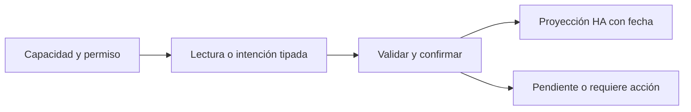

# Salud del sistema, entorno, pilas y mantenimientos

- Status: Draft
- Date: 2026-11-24
- Catalog capability ID: system-health-and-maintenance
- Last verified: 2026-11-24, investigación y diseño; implementación futura
- Owners: My Verisure maintainers
- Scope: diagnósticos, avisos, medidas ambientales verificadas, procesos DIY y agenda técnica
- Required review gates: behavior, architecture, testing, documentation, security/operations
- Open decisions blocking readiness: fuente/unidades de cada medida ambiental, semántica DSR por dispositivo, efectos y finalización de DIY, contratos de reprogramación/cancelación de cita y evidencia de entrega de avisos

## 1. Executive summary

Mostrar hechos de salud y mantenimiento con su fuente y antigüedad. Las métricas no presentes siguen desconocidas; una alerta de pila baja no inventa porcentaje y la meteorología exterior no es un sensor interior.

Se aplica íntegramente la [base común de gestión](app-management-foundation.md), especialmente permisos, admisión, privacidad, confirmación y aislamiento.

## 2. Problem, current behavior and evidence

La app ofrece Mi alarma al día, Información de dispositivos, Confort y clima, sustitución de pilas y visitas. Existen contratos DSR, revisiones, tamper, DIY y envíos. La ayuda oficial indica que el proceso guiado permite cambiar pilas sin generar una alarma: iniciarlo es una acción operativa, incluso si usa una query GraphQL.

La [auditoría](../docs/technical/2026-11-24-app-capability-audit.md) y el [inventario de operaciones](../docs/validation/2026-11-24-app-capabilities.json) separan fuente estática, UI nativa/web y consultas observadas. Este SDD no declara nuevas funciones instaladas.

## 3. Actors, surfaces and terminology

Diagnóstico, aviso, porcentaje, medida física, previsión del tiempo, incidencia, envío de pilas y ventana de mantenimiento son recursos separados.

Actores: usuario HA autorizado, principal/rol Verisure, recurso de la cuenta o instalación y adaptadores HA/CLI. La visibilidad de un menú no otorga permisos de backend.

## 4. Goals, non-goals and fixed invariants

- HEALTH-1 — **Salud verificable:** Proyectar sólo diagnósticos explícitos por dispositivo y no convertir ausencia de incidencias en salud confirmada de todos los sensores.
- HEALTH-2 — **Unidades y entorno:** Crear sensores ambientales sólo con fuente, unidad y timestamp verificados; separar Confort y clima de la tarjeta meteorológica del inicio.
- HEALTH-3 — **Pilas y tamper:** Distinguir alerta, nivel numérico y estado de manipulación; no limpiar un tamper o alarma por una notificación recibida.
- HEALTH-4 — **Ventana DIY:** Inicio, ampliación y cierre del proceso guiado requieren intención, elegibilidad y confirmación; query no implica ausencia de efectos.
- HEALTH-5 — **Envíos y contactos:** Leer tracking/fechas con permiso y ocultar dirección/documentos; pedir pilas, llamar a soporte o gestionar citas no es un efecto automático de un sensor.
- HEALTH-6 — **Agenda e informes:** Separar lista/capacidad de cita, cambio de cita e informe de revisión; no inferir que un slot ofertado está reservado.
- HEALTH-7 — **Recuperación:** Restaurar observaciones con antigüedad y reconciliar procesos activos sin reiniciarlos, cancelarlos o ampliar protección suspendida automáticamente.

Las pruebas domésticas mantienen la prohibición de interior total. No se realizan compras, emergencias o actuaciones físicas por inferirlas de una notificación.

## 5. Current versus intended journey

Equivalente: permiso del recurso → lectura/intención concreta → validación y confirmación → representación HA. Si falta contrato, permiso o resultado, no se publica un éxito. El estado actual es investigación; la implementación seguirá esta separación.

## 6. Functional behavior and state model

| Área | Referencias | Estado de evidencia |
|---|---|---|
| Diagnóstico | `xSGetDSRDevicesInfo`, últimas revisiones e informes | contratos estáticos; fuentes por dispositivo pendientes |
| Pilas/tamper | DIYList, DIYGetTamper, DIYBatteriesTracking/Details | separar notificación y dato actual |
| Proceso guiado | DIYInit, DIYCheck, DiyAcceptance, Received/Rejection/Resend/Contingency | posibles efectos operativos; no son polling |
| Visitas | Maintenances, AppointmentDIYCapacity, xSAppointmentCapacity | modificar/cancelar requiere contrato adicional |
| Entorno | Confort y clima; fuente exacta sin capturar | no atribuir telemetría a AllInOne sólo por su nombre |
| Soporte | mkCallMeMutation y canales oficiales | acción explícita/manual, nunca respuesta automática a un aviso |

Entidades diagnóstico y calendario propuestos sólo para fuentes demostradas. Procesos DIY: elegible → preparación → activo → finalización confirmada o requiere intervención; sus estados no se derivan sólo del tiempo transcurrido. Los avisos de inhibición/corriente/humo/agua no prueban telemetría continua ni disponibilidad de todos esos dispositivos.

Aplicar estados unknown/stale/pending/confirmed/partial/ambiguous según la base común. Un resultado antiguo, duplicado o cancelado no sustituye hechos más recientes.

## 7. User-facing configuration

Lecturas y diagnóstico opt-in, procesos operativos desactivados por defecto. Sensores de battery/problem/connectivity y unidades HA apropiadas únicamente si hay datos reales. Datos de envío/dirección sólo mediante respuesta privada. Sin flujo de pedido o mantenimiento al iniciar HA.

## 8. Clean Architecture design

Puertos `SystemHealthRepository`, `EnvironmentRepository`, `MaintenanceRepository` y modelos separados. Adaptadores GraphQL, transporte ambiental y calendarios no contaminan el core. Notificaciones usan el hub existente y sólo generan reconciliaciones permitidas.

Las rutas y tipos anteriores son propuestas. Reutilizar el grafo por entrada, las sesiones, el gate de proveedor y los mecanismos de publicación existentes. Extender el guardián de arquitectura y comprobar importaciones sin HA.

## 9. UI/UX and content contract

Mostrar «Aviso de pila baja», «Nivel no disponible», «Mantenimiento pendiente de finalización» y «Última revisión conocida». Reservas y disponibilidad usan etiquetas diferentes. No diagnosticar hardware a partir del texto libre de un aviso.

Etiquetas accesibles, localización y controles equivalentes en móvil/escritorio. Las acciones propuestas aún no existen en la versión instalada.

## 10. Failure, recovery and cleanup

Proceso activo y timeout: conservar estado incierto y guiar al flujo oficial; no extender ventanas ni marcar cerrado sin confirmación. Un fallo de informes no cambia el panel a saludable. Archivos temporales se borran al terminar o cancelar.

Unload cancela seguimiento y drena persistencia; no equivale a deshacer la operación remota. Limpiar temporales propios conservando hechos confirmados y evidencia privada mínima.

## 11. Security, permissions and privacy

Procesos que reducen la protección requieren permiso y supervisión; no automatizar bypass o supresión de tamper. Domicilios, teléfonos, informes y tracking no se incluyen en atributos públicos ni logs. No provocar alertas reales para probar fuentes.

Se aplican controles de ámbito/rol vigentes y autorización explícita de automatizaciones de APP-6/7. Fixtures sintéticas; ningún secreto, dirección, identificador doméstico o captura HAR se incorpora al repositorio.

## 12. Observability and operations

Sin consultas radio exhaustivas durante polling de alarma. Datos de revisión/agenda con caché y fecha; actualización explícita o aviso validado. Limitar tamaño/tiempo de descargas e incluir su caducidad.

Registrar duración, resultado y motivo local; sin mensajes arbitrarios del proveedor. Los presupuestos comunes son propuestas sujetas a medición, no límites oficiales.

## 13. Compatibility, migration, rollout and rollback

Habilitación por entrada y capacidad, primero lecturas, después escrituras manuales autorizadas. Preservar UUID, FCM, credenciales, unique_id y automatizaciones existentes. Eliminar/desactivar soporte local no modifica recursos remotos. Rollback mantiene snapshots privados versionados y deja las funciones incompatibles desactivadas.

## 14. Testing strategy and numeric budget

28 casos: siete riesgos por cuatro variantes, con unidad desconocida, medida antigua, aviso sin nivel, ventana DIY activa al reiniciar y consulta de slot sin reserva.

Son mínimos propuestos para la futura implementación, no tests ya escritos ni cobertura medida. Usar relojes/repositorios/HTTP falsos y cero llamadas domésticas en CI; exigir 100% de líneas/rama en políticas críticas y constructores de mutaciones nuevos y respetar los gates del proyecto.

## 15. Documentation and discoverability

Mantener este SDD, [CATALOG.md](CATALOG.md), el inventario de operaciones y la auditoría. La futura implementación añadirá guía específica, acciones, permisos, migración y ejemplos con valores ficticios. No anunciar la capacidad como disponible antes de su aceptación.

## 16. Acceptance scenarios

| Requisito | Given / When / Then resumido |
|---|---|
| HEALTH-1 | El backend omite un dispositivo; no se publica normal ni batería completa. |
| HEALTH-2 | Sólo existe temperatura meteorológica; no se crea temperatura interior ni CO2 supuesto. |
| HEALTH-3 | Llega aviso de pilas; HA muestra su categoría sin falsear porcentaje o resolver tamper. |
| HEALTH-4 | Se carga el dashboard; nunca se llama DIYInit ni se abre una ventana de mantenimiento. |
| HEALTH-5 | Hay pila baja; se informa, sin crear pedidos, mensajes ni llamadas. |
| HEALTH-6 | Se consulta disponibilidad; el calendario no muestra una reserva confirmada. |
| HEALTH-7 | HA vuelve durante DIY; consulta estado y muestra intervención pendiente sin iniciar otro proceso. |

Cada escenario se descompone en variantes de tipos, autorización, error, concurrencia y recuperación según el presupuesto. La validación física requiere autorización concreta independiente.

## 17. Requirements traceability

| ID | Riesgo/función | Verificación futura | Responsable de implementación |
|---|---|---|---|
| HEALTH-1 | Salud verificable | Caso de aceptación HEALTH-1; matriz sintética de §14 | Política/caso de uso y adaptador descritos en §8 |
| HEALTH-2 | Unidades y entorno | Caso de aceptación HEALTH-2; matriz sintética de §14 | Política/caso de uso y adaptador descritos en §8 |
| HEALTH-3 | Pilas y tamper | Caso de aceptación HEALTH-3; matriz sintética de §14 | Política/caso de uso y adaptador descritos en §8 |
| HEALTH-4 | Ventana DIY | Caso de aceptación HEALTH-4; matriz sintética de §14 | Política/caso de uso y adaptador descritos en §8 |
| HEALTH-5 | Envíos y contactos | Caso de aceptación HEALTH-5; matriz sintética de §14 | Política/caso de uso y adaptador descritos en §8 |
| HEALTH-6 | Agenda e informes | Caso de aceptación HEALTH-6; matriz sintética de §14 | Política/caso de uso y adaptador descritos en §8 |
| HEALTH-7 | Recuperación | Caso de aceptación HEALTH-7; matriz sintética de §14 | Política/caso de uso y adaptador descritos en §8 |

Tests propuestos: `test_system_health.py, test_environment_sources.py, test_maintenance_state_machine.py, test_maintenance_privacy.py`. Son nombres de trabajo futuros, sin atribuirles ejecución actual. La evidencia disponible está en §2/6; los bloqueos del encabezado deben cerrarse antes de Ready for implementation.

## 18. Implementation or maintenance sequence

Revisar contratos y bloqueos → modelos/puertos semánticos → casos de uso con fakes → matriz de errores/privacidad → adaptador proveedor → presentación HA/CLI → compatibilidad/migración → lecturas controladas → escrituras concretas autorizadas cuando apliquen → rollout. No usar una prueba física peligrosa para completar una matriz sintética.

## 19. Definition of Done

- [ ] Requisitos y escenarios trazados; bloqueos de protocolo/permiso resueltos.
- [ ] Contratos por panel/hardware y confirmación comprobados.
- [ ] Tests, cobertura crítica, aislamiento, cancelación y privacidad verificados.
- [ ] Migración, rollback, guías y catálogo actualizados.
- [ ] Evidencia UI, sintética y física separadas, con sus límites publicados.

## 20. References and decisions

[Dispositivos y mantenimiento](https://www.verisure.es/cliente/dispositivos) · [Eventos](notification-observability-and-automation.md) · [Administración protegida](protected-account-administration.md)

[Base común](app-management-foundation.md) · [Norma de SDDs](README.md) · [Decisión de dependencias](../docs/adr/0001-core-and-adapter-dependencies.md). Estado Draft: la elección de exposiciones HA es una recomendación de diseño, no un comportamiento observado del proveedor.
